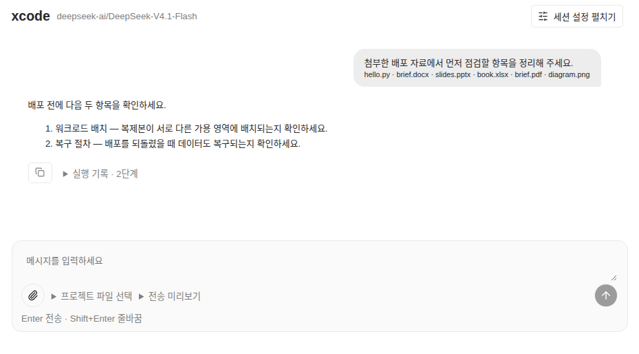
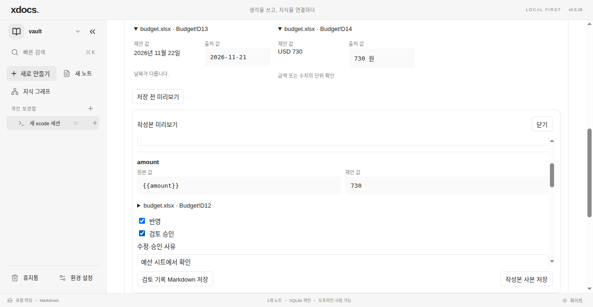
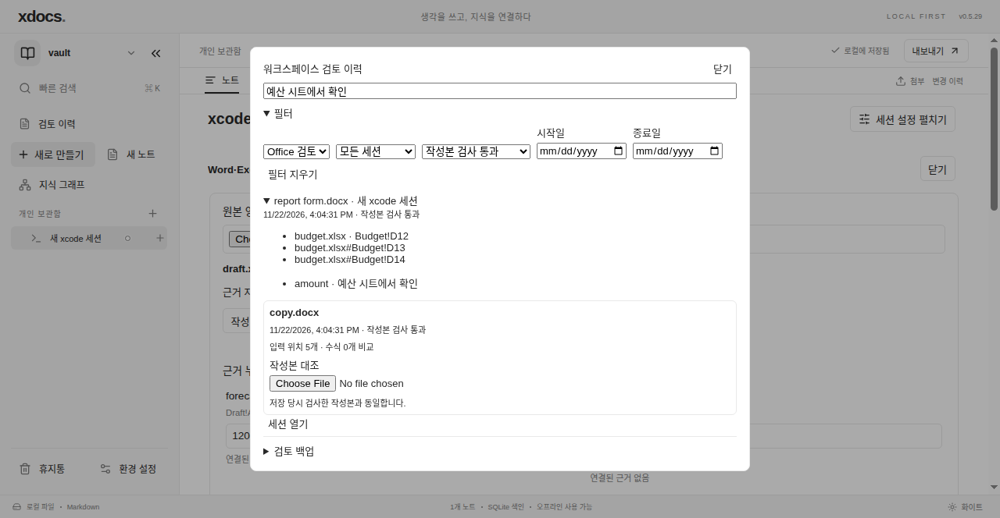
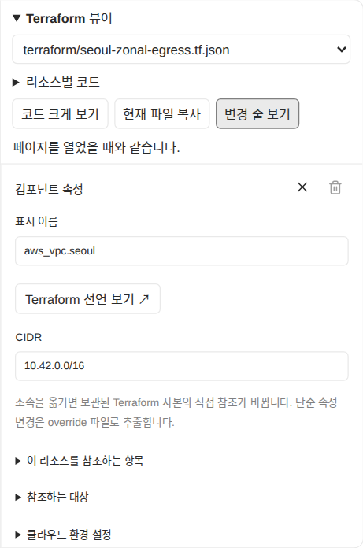
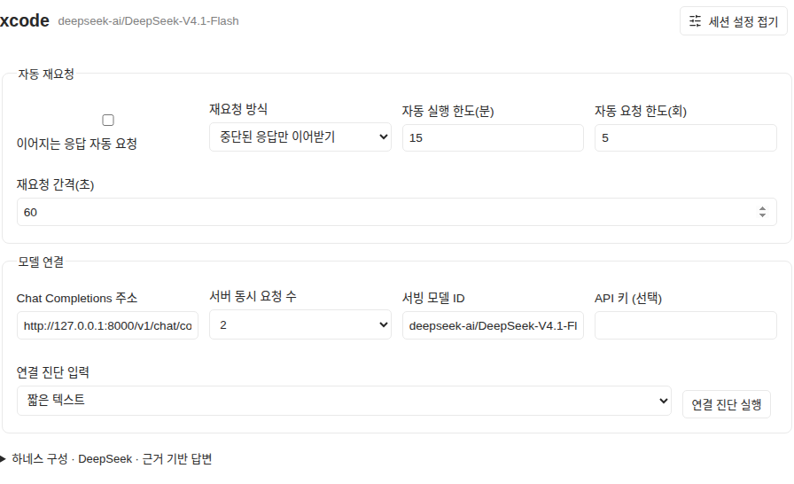
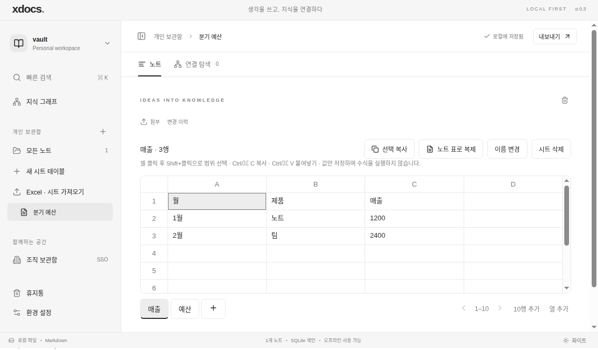

# xdocs

[English](README.md) · **한국어**

**생각을 쓰고, 지식을 연결하는 로컬 노트 앱.**

Markdown 파일은 내 폴더에, 검색·연결 정보는 SQLite에 저장합니다. 로그인 없이 오프라인에서 사용할 수 있습니다. 현재는 **v0.5.34 정식 릴리스**입니다.

[설치 파일 다운로드](https://github.com/uknowpro/xdocs/releases/tag/v0.5.34) · Ubuntu, macOS, Windows용입니다. Windows 설치 파일은 서명되지 않았으며 macOS 빌드는 공증되지 않았습니다.







## 주요 기능

- **노트와 시트** — 블록이나 Markdown으로 편집하고 백링크, 그래프 검색, 변경 이력을 이용합니다. Excel·CSV·TSV를 파일 또는 폴더 단위로 가져오면 파일마다 페이지가 생기고 시트가 탭으로 표시됩니다. 가장자리까지 드래그해 선택을 확장하고 탭 구분 텍스트로 복사합니다. [시트 사용법](docs/sheets.md)
- **xinfra** — AWS·Azure·GCP·멀티클라우드의 오프라인 설계 35종을 제공합니다. Terraform 주소로 검색하고, 선택한 경계를 화면에 맞춰 보거나 선언으로 이동합니다. 변경 파일을 앞뒤로 넘겨 검토하고 지원 컴포넌트를 Terraform·CloudFormation·Helm·Kubernetes 매니페스트로 추출합니다. [캔버스 사용법](docs/iacd.md)
- **인프라 문서와 자동화** — Terraform/OpenTofu·Kubernetes·Compose의 의존성을 보고 운영 메모를 작성합니다. 로컬 원문과 관계 도면을 오갈 수 있습니다. GitHub Actions·Jenkins·Ansible·CloudFormation 캔버스에서 원문과 블록을 전환하면 커서와 스크롤 위치를 복원합니다. [인프라 문서](docs/infrastructure.md) · [자동화 캔버스](docs/automation-canvas-review.md)
- **xcode와 Harness** — Chat Completions 주소·모델명·토큰(선택)을 입력하거나 JSON 설정을 가져옵니다. 여러 세션을 동시에 실행하고 문서를 첨부하거나 직무별 하네스를 적용합니다. Word·Excel 양식은 값을 검토한 뒤 사본으로 저장합니다. 첨부 초안 복구, 후속 요청 대기·즉시 전환, 대화 검색·분기, 답변을 연결된 노트로 저장하기를 지원합니다. 워크스페이스 자료를 범위별로 첨부하고 원본에서 확인하거나, 여러 노트에 반영할 변경을 검토하고 되돌릴 수 있습니다. [세션](docs/xcode.md) · [Builder](docs/brainboard-builder.md)
- **Analyzer** — 내장 netspector·kubewiser·Helm으로 로컬에서 분석합니다. 파일별 경로 근거를 보고, 재분석 뒤 같은 경로로 돌아가거나 Kubernetes 업그레이드 결과를 비교합니다. [Analyzer 사용법](docs/analyzer.md)
- **조직 워크스페이스** — SSO, 오프라인 동기화, 공동 편집과 문서별 권한을 지원합니다. 충돌이 생기면 두 버전을 비교하고 내 변경을 사본으로 남길 수 있습니다. [서버 설정](docs/server.md)

<details>
<summary>템플릿 카탈로그, Terraform 속성, 세션 설정 및 시트 화면</summary>






</details>

## 실행

Node.js 24 이상과 데스크톱 환경이 필요합니다.

```sh
git clone https://github.com/uknowpro/xdocs.git
cd xdocs
npm ci
npm start
```

앱에서 보관함 폴더를 선택하세요. `npm run dev`는 브라우저 저장소를 사용하는 UI 미리보기이며 실제 파일 저장은 데스크톱 앱에서 지원합니다.

## 업데이트와 데이터

**앱 폴더 밖에 둔 보관함의 Markdown 원본은 앱 코드 업데이트와 분리되어 유지됩니다.** 같은 보관함을 다시 열면 기존 노트를 읽습니다. SQLite는 파일에서 재생성할 수 있는 색인입니다.

v0.1 보관함의 원본·ID 보존과 색인 갱신을 테스트했습니다. 설치형 업데이트 UI는 포함되어 있으나 서명된 실제 릴리스 간 설치 검증은 아직 필요합니다. 업데이트 전에는 저장을 마치고 앱을 종료한 뒤 **보관함 전체를 백업**하세요. 브라우저 미리보기 데이터는 브라우저 데이터 삭제 시 사라질 수 있습니다.

## 개발

```sh
npm test              # 저장소 테스트
npm run build         # 타입 검사와 빌드
npm run test:ui       # Playwright UI 테스트
npm run test:desktop  # 빌드 후 Electron 실행 검증
npm run dist          # 현재 OS 패키징
```

Ubuntu와 GitHub Actions의 macOS·Windows에서 기본 실행 검사를 통과했습니다. 사용자 기기에서의 설치·업데이트와 서명 검증은 별도로 필요합니다.

[xinfra 사용법](docs/iacd.md) · [인프라 문서](docs/infrastructure.md) · [시트 사용법](docs/sheets.md) · [사용·개발 가이드](docs/guide.md) · [조직 서버 설정](docs/server.md) · [아키텍처](docs/architecture.md) · [PolyForm Internal Use License 1.0.0](LICENSE)

자신과 회사의 내부 업무를 위한 사용·수정·파생물 제작을 허용합니다. 외부 배포에는 별도 허가가 필요합니다.

이전에 MIT로 공개한 코드와 제3자 구성요소에는 각각 기존 허가가 유지됩니다.
