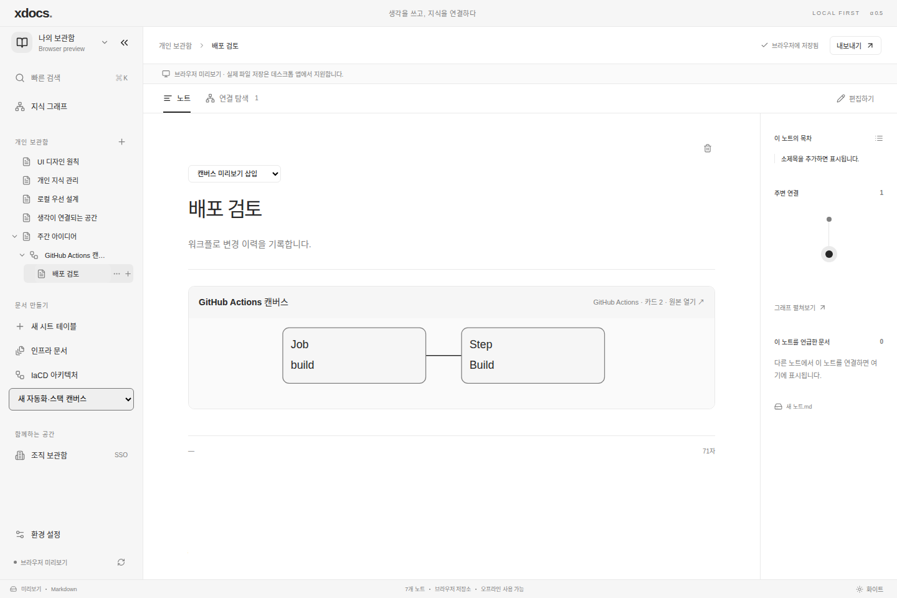
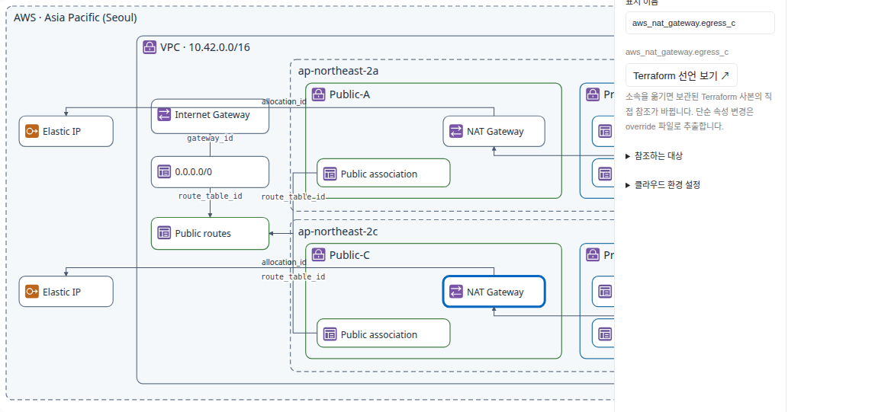
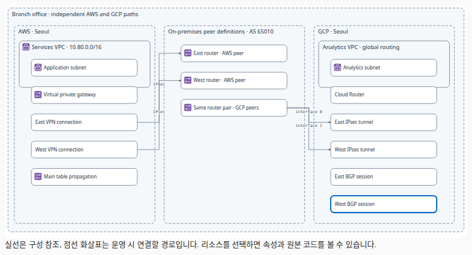
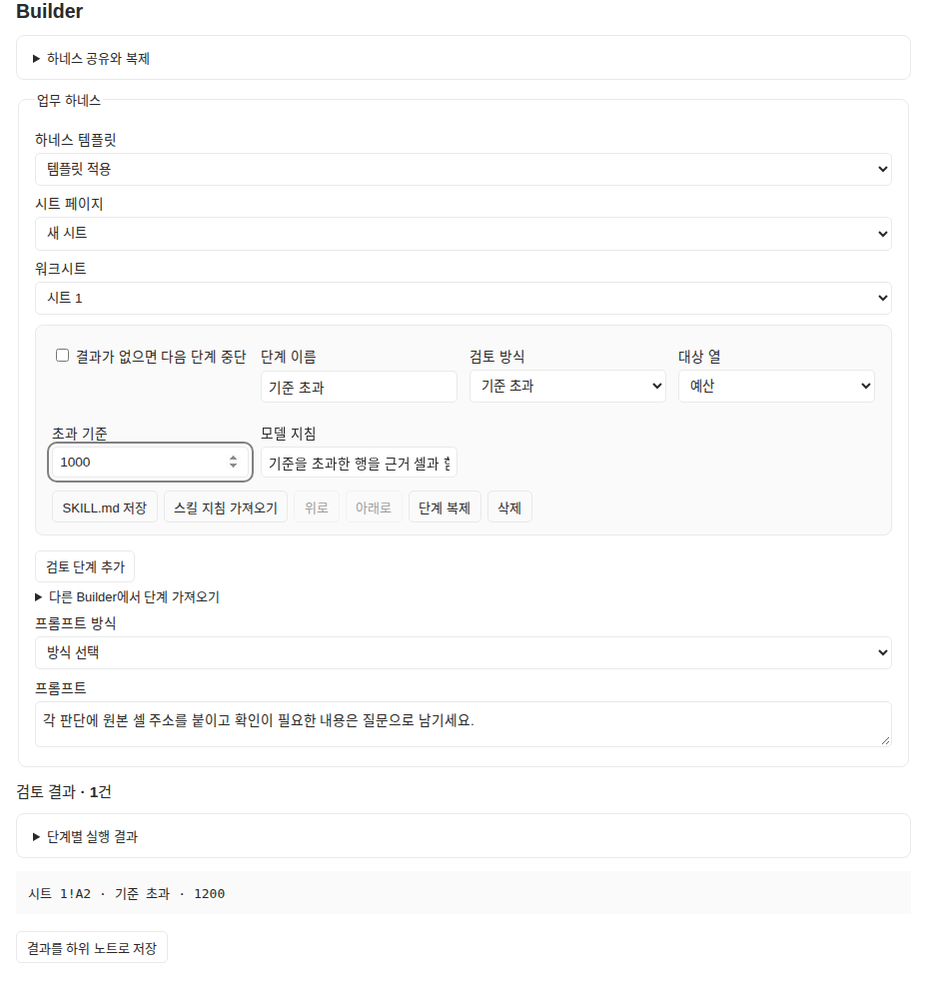
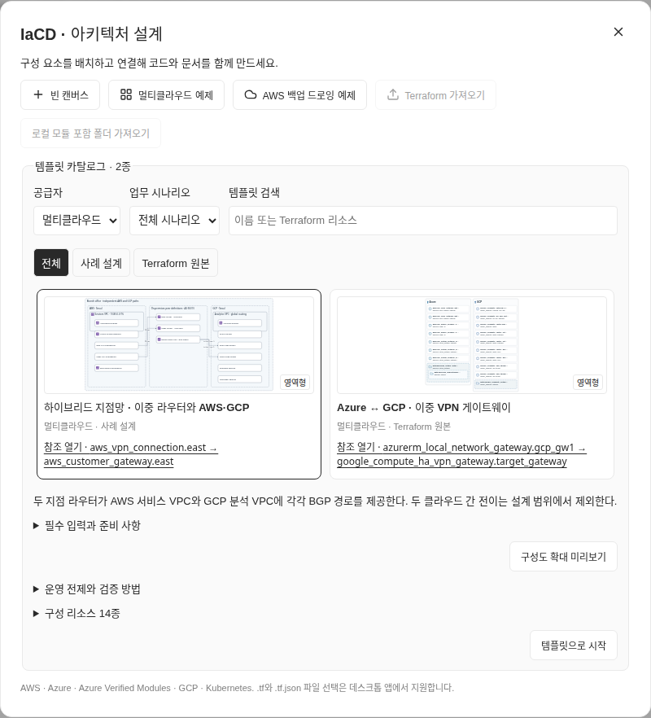
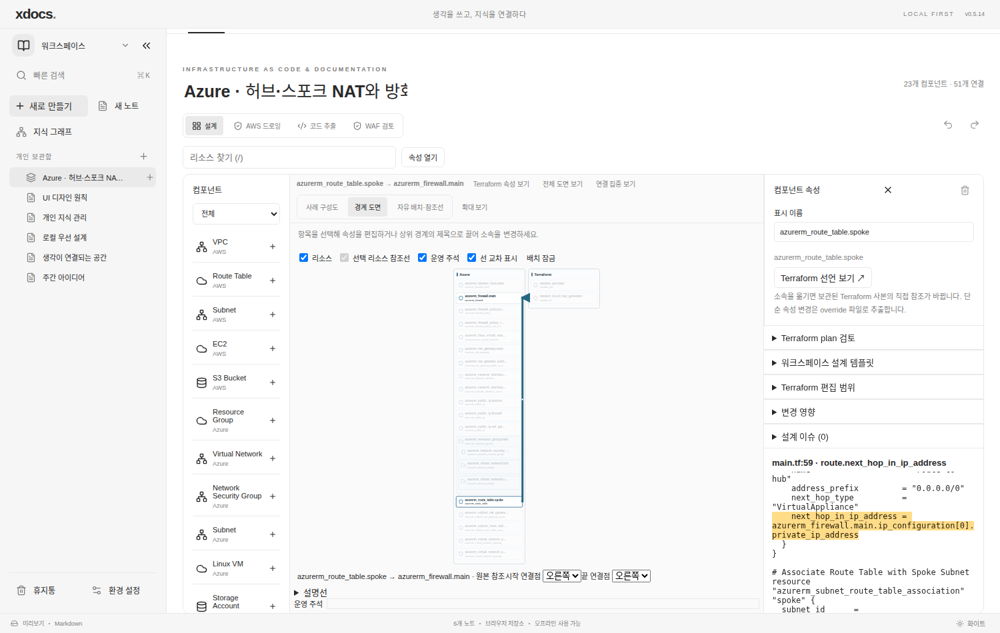

# xdocs

[English](README.md) · **한국어**

**생각을 쓰고, 지식을 연결하는 로컬 노트 앱.**

Markdown 파일은 내 폴더에, 검색·연결 정보는 SQLite에 저장합니다. 로그인 없이 오프라인에서 사용할 수 있습니다. 현재는 **v0.5.12 개발용 프리릴리스**입니다.


## 주요 기능

- 화이트·그레이·다크·시스템 테마
- Markdown·블록 편집, 자동 저장·변경 이력·휴지통 복원
- 제목·본문 검색, 노트 링크·백링크·그래프
- 이미지·PDF 첨부, Markdown·HTML 가져오기, Markdown·HTML·PDF 내보내기
- 시트 탭형 테이블·Excel/CSV/TSV 가져오기·탭 구분 클립보드
- Terraform/OpenTofu·Kubernetes·Compose 인프라 목록·관계·운영 메모·변경 비교
- **xcode** — 프로젝트 파일을 첨부하고 셀프서빙 모델의 답변을 실시간으로 읽습니다. 오른쪽 위 **세션 설정 펼치기**에서 API 주소·토큰(선택)·모델명만 입력하면 됩니다. 연결·재요청 옵션은 `settings.json`으로도 불러오거나 편집할 수 있습니다. 로컬 세션은 중단된 단계부터 다시 실행할 수 있습니다. [세션 사용법](docs/xcode.md)
- **Analyzer** — netspector·kubewiser v0.2.0-alpha.10·Helm이 앱에 포함되어 별도 설치 없이 로컬에서 분석합니다. 프로젝트 네트워크 경로와 Kubernetes·Helm 호환성을 분석하고, 업그레이드 조치를 하위 노트로 저장해 Builder에서 검토합니다. [Analyzer 사용법](docs/analyzer.md)
- 조직 보관함·SSO·오프라인 동기화·블록 공동 편집·문서별 편집 제한

[설치 파일 다운로드](https://github.com/uknowpro/xdocs/releases/tag/v0.5.12) — 코드 서명·공증 없는 개발용 프리릴리스입니다.

IaCD의 기본 경계 도면에서 **AWS VPC → Subnet → EC2**, **Azure Resource Group → VNet → Subnet**, **GCP VPC → Subnetwork → VM**을 중첩해서 표시합니다. 이름·Terraform 주소로 리소스를 찾고 선택한 경계 안에 컴포넌트를 추가할 수 있습니다. 경계를 접거나 잠그고, 참조선과 운영 주석을 선택해 볼 수 있습니다. 속성 또는 드래그로 소속을 변경하고 Terraform·CloudFormation·Helm으로 내보낼 수 있습니다. 사이드바의 **새로 만들기 → 새 자동화·스택 캔버스**에서 GitHub Actions, Ansible, Jenkins Declarative, CloudFormation 파일을 가져와 카드별 원문을 편집할 수 있습니다. [캔버스 사용법](docs/automation-canvas-review.md)

워크스페이스의 **페이지 트리**에서 노트와 캔버스를 함께 탐색합니다. **새로 만들기**에서 시트·캔버스·도구를 열고, 상단 워크스페이스 이름을 눌러 개인·조직 공간을 선택합니다. 개인 보관함의 **+**는 새 폴더, 폴더 옆 **+**는 새 노트를 만듭니다. 폴더의 **+ 옆 ▾**에서 이 폴더의 기본 동작을 **새 xcode 세션**으로 바꿀 수 있습니다. 같은 곳의 **하위 페이지 추가**에서는 하위 폴더·시트·캔버스도 만들 수 있습니다. 데스크톱의 **Excel·CSV 폴더 가져오기**는 디렉터리 구조와 시트 탭을 유지하며 파일마다 페이지를 만듭니다. IaCD 카탈로그에서 공급자·업무 시나리오·편집 방식으로 템플릿을 찾고, 필수 루트 변수와 운영 전제를 확인합니다. 카드의 **참조 열기**를 누르면 두 리소스와 상위 경계가 강조되고 연결선을 눌러 해당 Terraform 속성으로 이동합니다. 로컬 plan JSON의 작업을 도면에서 검토하고 직접 만든 경계를 워크스페이스 템플릿으로 재사용할 수 있습니다. 캔버스 옆 Terraform 뷰어에서 편집 결과와 파일별 변경 줄을 확인합니다. 속성의 **Terraform 선언 보기**로 코드를 확인하고 **캔버스에서 보기**로 같은 리소스에 돌아갑니다. 페이지를 끌어 하위 트리를 이동하고 순서를 조정합니다. 일반 노트의 **캔버스 미리보기 삽입**으로 원본을 연결하세요. 미리보기를 누르면 같은 캔버스가 열립니다.

<details>
<summary>xcode 채팅과 세션 설정 화면</summary>


</details>

<details>
<summary>AWS 계정 간 백업 드로잉과 노트 미리보기</summary>




</details>

<details>
<summary>IaCD 아키텍처 캔버스 보기</summary>

**IaCD → 사례 설계**에서 서울 이중 AZ 이그레스, EKS 사설 운영 플랫폼, 이중 라우터 기반 AWS·GCP 지점망, Azure 허브·스포크, GCP 서울·도쿄 Shared VPC 설계를 열 수 있습니다. 구성도에서 리소스를 선택하면 속성과 Terraform 원본을 확인할 수 있습니다. 점선 화살표는 운영 시 연결할 경로입니다.






</details>

<details>
<summary>GitHub Actions 캔버스 보기</summary>


</details>

## 실행

Node.js 24 이상과 데스크톱 환경이 필요합니다.

```sh
git clone https://github.com/uknowpro/xdocs.git
cd xdocs
npm ci
npm start
```

앱에서 보관함 폴더를 선택하세요. `npm run dev`는 브라우저 저장소를 사용하는 UI 미리보기이며 실제 파일 저장은 데스크톱 앱에서 지원합니다.

## 업데이트와 데이터

**앱 폴더 밖에 둔 보관함의 Markdown 원본은 앱 코드 업데이트와 분리되어 유지됩니다.** 같은 보관함을 다시 열면 기존 노트를 읽습니다. SQLite는 파일에서 재생성할 수 있는 색인입니다.

v0.1 보관함의 원본·ID 보존과 색인 갱신을 테스트했습니다. 설치형 업데이트 UI는 포함되어 있으나 서명된 실제 릴리스 간 설치 검증은 아직 필요합니다. 업데이트 전에는 저장을 마치고 앱을 종료한 뒤 **보관함 전체를 백업**하세요. 브라우저 미리보기 데이터는 브라우저 데이터 삭제 시 사라질 수 있습니다.

## 개발

```sh
npm test              # 저장소 테스트
npm run build         # 타입 검사와 빌드
npm run test:ui       # Playwright UI 테스트
npm run test:desktop  # 빌드 후 Electron 실행 검증
npm run dist          # 현재 OS 패키징
```

Ubuntu와 GitHub Actions의 macOS·Windows에서 기본 실행 검사를 통과했습니다. 사용자 기기에서의 설치·업데이트와 서명 검증은 별도로 필요합니다.

[IaCD 사용법](docs/iacd.md) · [인프라 문서](docs/infrastructure.md) · [시트 사용법](docs/sheets.md) · [사용·개발 가이드](docs/guide.md) · [조직 서버 설정](docs/server.md) · [아키텍처](docs/architecture.md) · [PolyForm Internal Use License 1.0.0](LICENSE)

자신과 회사의 내부 업무를 위한 사용·수정·파생물 제작을 허용합니다. 외부 배포에는 별도 허가가 필요합니다.

IaCD에는 **AWS 9종, Azure 19종, GCP 10종, 멀티클라우드 2종을 합쳐 총 40종**의 오프라인 IaCD 템플릿이 있습니다. 카드에서 주요 참조를 확인하고, EFS 계정 간 복원·Azure 방화벽 라우팅·BigQuery 배치 전환 사례를 도면에서 따라갈 수 있습니다. **Builder**는 시트·노트의 업무 하네스를 조합해 근거가 있는 결과 노트를 만듭니다. 데스크톱에서 호환 모델과 MCP 자료를 연결하고, 요청 실패 시 저장된 대체 모델로 재시도하거나 JSON 응답의 근거 누락을 확인할 수 있습니다. IaCD의 WAF 검토에서는 두 버전의 terraform-docs JSON을 열어 모듈 입출력 변경을 비교합니다. [Builder 사용법](docs/brainboard-builder.md)

<details>
<summary>Builder와 IaCD 템플릿 화면</summary>







</details>

이전에 MIT로 공개한 코드와 제3자 구성요소에는 각각 기존 허가가 유지됩니다.
