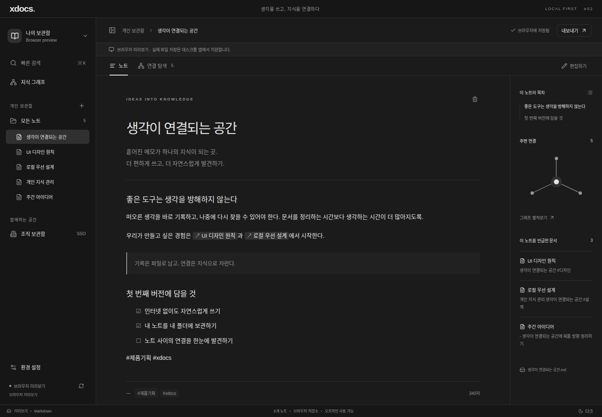

# xdocs

**생각을 쓰고, 지식을 연결하는 로컬 노트 앱.**

Markdown 파일은 내 폴더에, 검색·연결 정보는 SQLite에 저장합니다. 로그인 없이 오프라인에서 사용할 수 있습니다. 현재는 **v0.2.0 개발용 알파**입니다.



## 주요 기능

- 화이트·그레이·다크·시스템 테마
- Markdown·블록 편집, 자동 저장·변경 이력·휴지통 복원
- 제목·본문 검색, 노트 링크·백링크·그래프
- 이미지·PDF 첨부, Markdown·HTML 가져오기, Markdown·HTML·PDF 내보내기
- 조직 보관함·SSO·오프라인 동기화·Markdown 공동 편집

## 실행

Node.js 24 이상과 데스크톱 환경이 필요합니다.

```sh
git clone https://github.com/uknowpro/xdocs.git
cd xdocs
npm ci
npm start
```

앱에서 보관함 폴더를 선택하세요. `npm run dev`는 브라우저 저장소를 사용하는 UI 미리보기이며 실제 파일 저장은 데스크톱 앱에서 지원합니다.

## 업데이트와 데이터

**앱 폴더 밖에 둔 보관함의 Markdown 원본은 앱 코드 업데이트와 분리되어 유지됩니다.** 같은 보관함을 다시 열면 기존 노트를 읽습니다. SQLite는 파일에서 재생성할 수 있는 색인입니다.

v0.1 보관함의 원본·ID 보존과 색인 갱신을 테스트했습니다. 설치형 업데이트 UI는 포함되어 있으나 서명된 실제 릴리스 간 설치 검증은 아직 필요합니다. 업데이트 전에는 저장을 마치고 앱을 종료한 뒤 **보관함 전체를 백업**하세요. 브라우저 미리보기 데이터는 브라우저 데이터 삭제 시 사라질 수 있습니다.

## 개발

```sh
npm test              # 저장소 테스트
npm run build         # 타입 검사와 빌드
npm run test:ui       # Playwright UI 테스트
npm run test:desktop  # 빌드 후 Electron 실행 검증
npm run dist          # 현재 OS 패키징
```

Ubuntu 개발 환경에서 실행을 확인했습니다. macOS·Windows는 실제 OS 검증과 서명 작업이 필요합니다.

[사용·개발 가이드](docs/guide.md) · [조직 서버 설정](docs/server.md) · [아키텍처](docs/architecture.md) · [MIT License](LICENSE)
