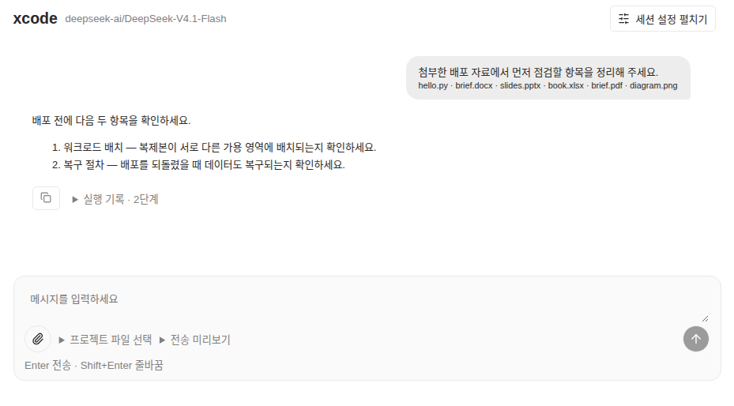
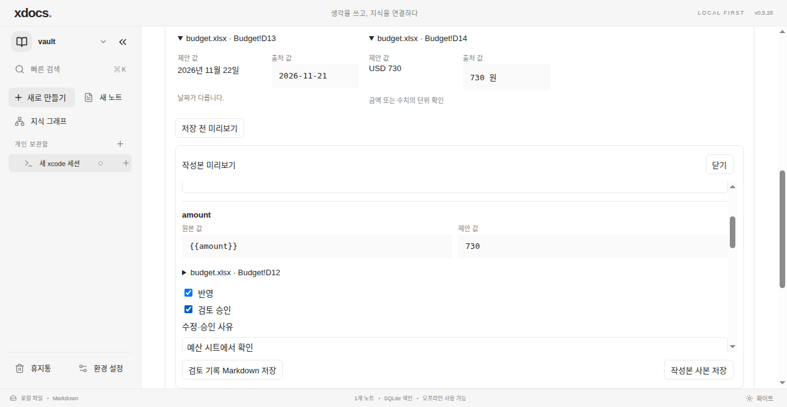
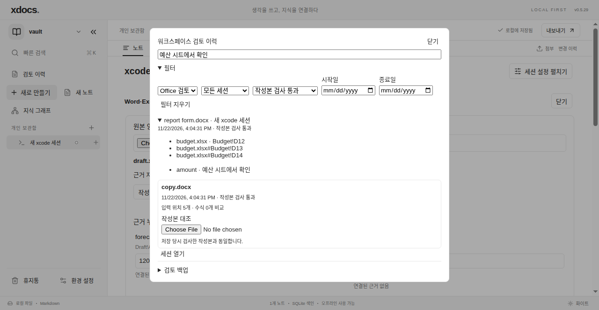
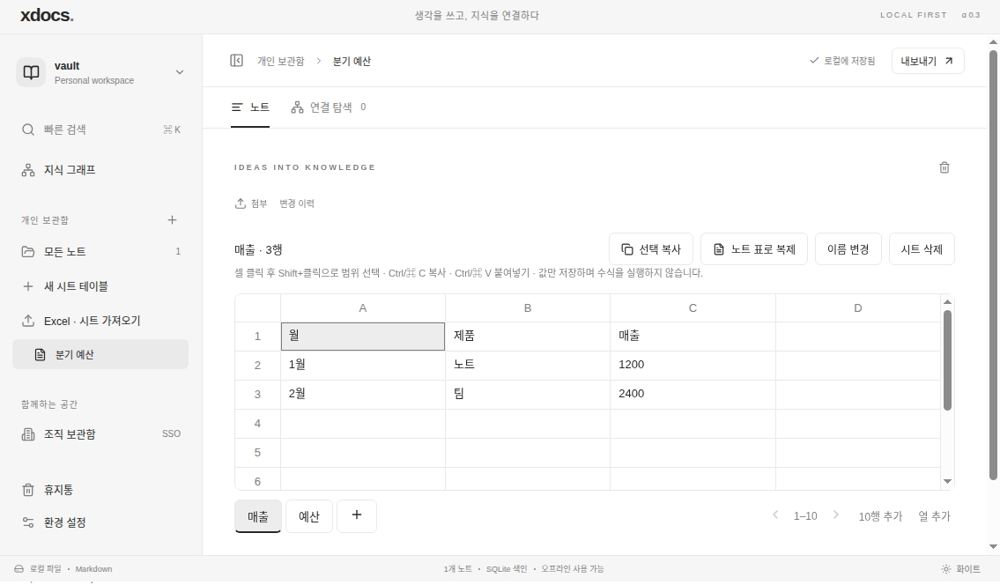

# xdocs

**English** · [한국어](README.ko.md)

A local-first desktop workspace for linked notes, spreadsheets and infrastructure diagrams. Keep Markdown files in your own folder and search them through a SQLite index. You can work offline without an account.

[Download the v0.5.29 development prerelease](https://github.com/uknowpro/xdocs/releases/tag/v0.5.29) for Ubuntu, macOS or Windows. Installers are unsigned and the macOS build is unnotarized.







## Inside a workspace

- **Notes and sheets.** Edit blocks or Markdown, follow backlinks, search the graph and restore revisions. Import Excel, CSV or TSV individually or by folder. Each workbook becomes a page with sheet tabs. Drag to extend a selection across the viewport and copy it as TSV. [Sheet guide](docs/sheets.md)
- **xinfra.** Browse 35 offline designs across AWS, Azure, GCP and multi-cloud. Search for a resource by Terraform address, fit a boundary to the viewport, inspect its declaration and step between changed files. Export supported components to Terraform, CloudFormation, Helm and Kubernetes manifests. [Canvas guide](docs/iacd.md)
- **Infrastructure and automation.** Inventory Terraform/OpenTofu, Kubernetes or Compose, inspect dependencies and record operating notes. Open local source files alongside the inventory. GitHub Actions, Jenkins, Ansible and CloudFormation canvases remember the cursor and scroll position when switching between blocks and the full source. [Infrastructure](docs/infrastructure.md) · [Automation](docs/automation-canvas-review.md)
- **xcode and Harness.** Configure a Chat Completions URL, model ID and optional token, or import session settings as JSON. Run concurrent sessions, attach documents and apply role-based harnesses. Review values before saving a filled Word or Excel copy. Keep attachment drafts, queue or redirect follow-ups, search and branch conversations, and save answers as linked notes. Attach selected workspace data, jump to sources, and review or undo edits across existing notes. [Sessions](docs/xcode.md) · [Builder](docs/brainboard-builder.md)
- **Analyzer.** Run bundled netspector, kubewiser and Helm locally. Review network paths by evidence file, revisit a selected path after a scan and compare Kubernetes upgrade findings. [Analyzer guide](docs/analyzer.md)
- **Team workspaces.** Connect an organization server for SSO, offline sync, collaborative editing and document permissions. Compare conflicting versions and choose whether to preserve a local copy. [Server setup](docs/server.md)

<details>
<summary>Template catalog, Terraform inspector, session settings and sheets</summary>




</details>

## Run from source

Use Node.js 24 or newer and a desktop session.

```sh
git clone https://github.com/uknowpro/xdocs.git
cd xdocs
npm ci
npm start
```

Choose a workspace folder when the desktop app opens. For a browser preview, run `npm run dev`. The preview uses browser storage, which is cleared when you remove site data.

## Updates and backups

Keep your workspace outside the application directory. After updating, reopen the same folder to read your Markdown files. The SQLite index can be rebuilt from those files. Migration tests cover v0.1 workspaces and preservation of note IDs. Before upgrading, finish saving, close the app and back up the entire workspace. Signed installer-to-installer upgrades still need validation on user devices.

## Development

```sh
npm test              # Unit and storage tests
npm run build         # Type check and build
npm run test:ui       # Playwright UI tests
npm run test:desktop  # Electron smoke test after building
npm run dist          # Package for the current OS
```

[User and developer guide](docs/guide.md) · [Architecture](docs/architecture.md) · [PolyForm Internal Use License 1.0.0](LICENSE)

You may use, modify and create derivative works for your internal business operations. External distribution requires separate permission.

Earlier MIT grants and third-party licenses continue to apply to their respective code.
