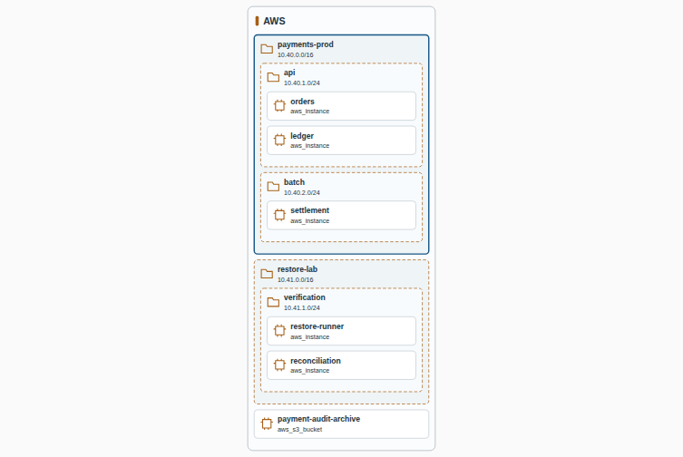
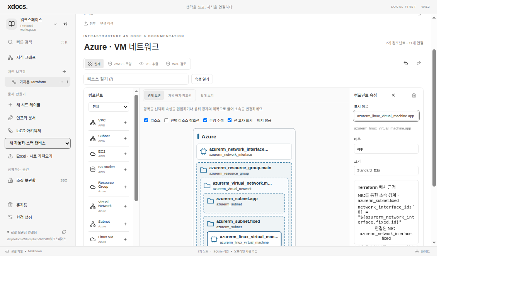
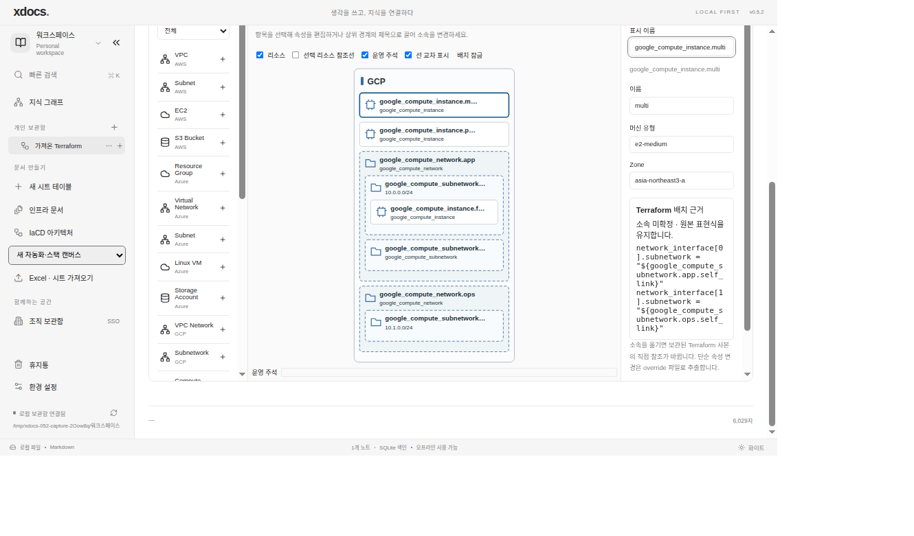

# xdocs

**English** · [한국어](README.ko.md)

A local-first desktop workspace for linked notes, spreadsheets and infrastructure diagrams. Keep Markdown files in your own folder and search them through a SQLite index. You can work offline without an account.

[Download the v0.5.2 development prerelease](https://github.com/uknowpro/xdocs/releases/tag/v0.5.2) for Ubuntu, macOS or Windows. Installers are unsigned and the macOS build is unnotarized. The features below describe the current main branch.


## Inside a workspace

- **Notes** — Organize pages in nested folders. Edit Markdown or blocks, follow backlinks, browse the graph, restore revisions, attach images and PDFs, import HTML or Markdown, and export Markdown, HTML or PDF. Choose light, gray, dark or system appearance.
- **Sheets** — Import Excel, CSV and TSV. Import a folder of workbooks to preserve the directory tree, with a page per workbook and a tab per sheet. Copy a selection as tab-separated text. [Sheet guide](docs/sheets.md)
- **Infrastructure** — Inventory Terraform/OpenTofu, Kubernetes and Compose resources, inspect relationships and record operational notes. Design nested cloud networks and move between a component and its Terraform declaration. Compare module input and output declarations across two versions using local terraform-docs JSON files. Preview each design in the template gallery before opening it. Browse 30 architecture case studies each for AWS, Azure and GCP plus two cross-cloud HA VPN designs. Each case includes a design question. Export supported components to Terraform, CloudFormation, Helm or Kubernetes manifests. [IaCD guide](docs/iacd.md) · [Infrastructure guide](docs/infrastructure.md)
- **Automation canvases** — Import GitHub Actions, Jenkins Declarative, Ansible and CloudFormation files, edit individual blocks, and embed a linked canvas preview in a note. [Canvas guide](docs/automation-canvas-review.md)
- **Analyzer** — Project scans run offline using the bundled netspector, kubewiser and Helm executables. Inspect project network paths, Kubernetes manifests and Helm charts. Compare Kubernetes versions and save findings as a linked report for Builder. [Analyzer guide](docs/analyzer.md)
- **Builder** — Assemble review steps around a sheet or note, trace findings to cells or lines, and save results to a child note. Desktop users can connect compatible model endpoints and MCP resources, retry with a saved model profile, and check structured responses for missing evidence. [Builder guide](docs/brainboard-builder.md)
- **Team workspaces** — Connect an organization server for SSO, offline sync, collaborative block editing and per-document editing permissions. [Server setup](docs/server.md)

<details>
<summary>Architecture and automation screenshots</summary>

In the AWS catalog, open **결제 서비스 · 격리 복구 리허설** to see an EC2 instance inside its subnet and VPC. Cards marked **영역형** show nested resource boundaries.








</details>

<details>
<summary>Builder and cloud template catalog</summary>


</details>

## Run from source

Use Node.js 24 or newer and a desktop session.

```sh
git clone https://github.com/uknowpro/xdocs.git
cd xdocs
npm ci
npm start
```

Choose a workspace folder when the desktop app opens. For a browser preview, run `npm run dev`. The preview uses browser storage, which is cleared when you remove site data.

## Updates and backups

Keep your workspace outside the application directory. After updating, reopen the same folder to read your Markdown files. The SQLite index can be rebuilt from those files. Migration tests cover v0.1 workspaces and preservation of note IDs. Before upgrading, finish saving, close the app and back up the entire workspace. Signed installer-to-installer upgrades still need validation on user devices.

## Development

```sh
npm test              # Unit and storage tests
npm run build         # Type check and build
npm run test:ui       # Playwright UI tests
npm run test:desktop  # Electron smoke test after building
npm run dist          # Package for the current OS
```

[User and developer guide](docs/guide.md) · [Architecture](docs/architecture.md) · [xdocs Proprietary Software License](LICENSE)
