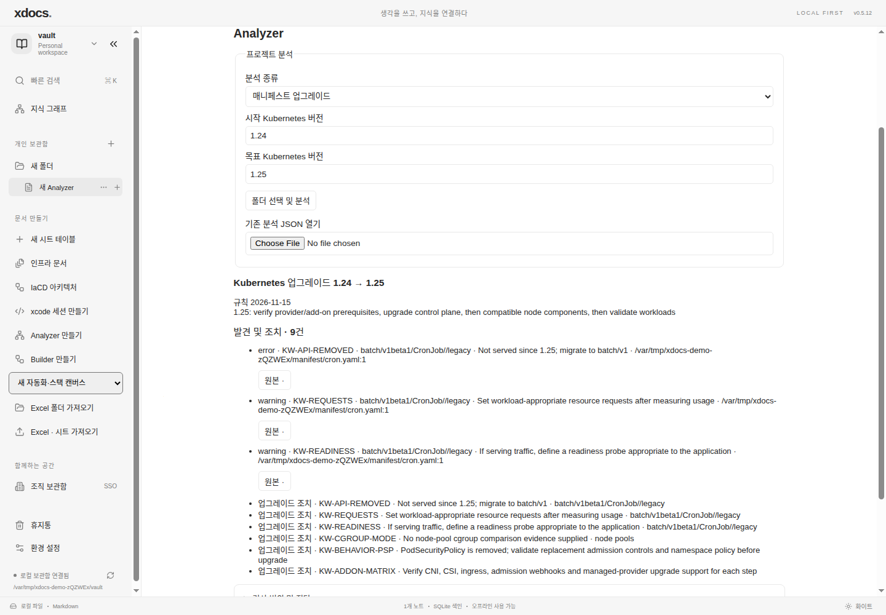
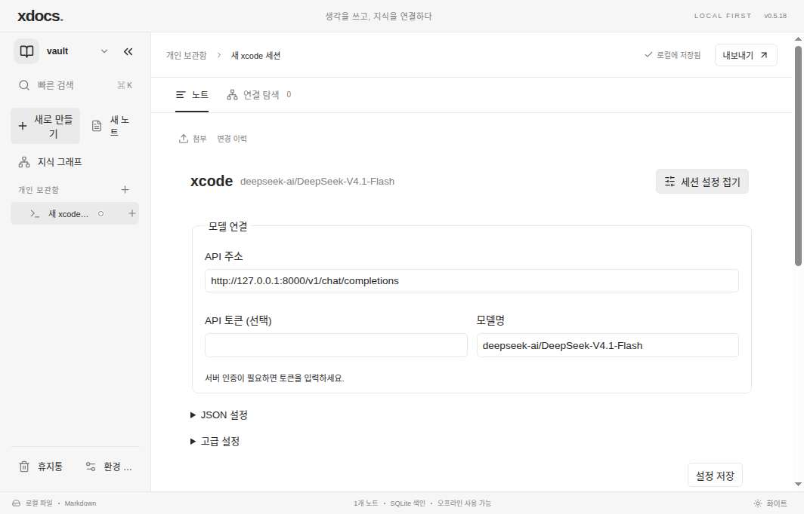
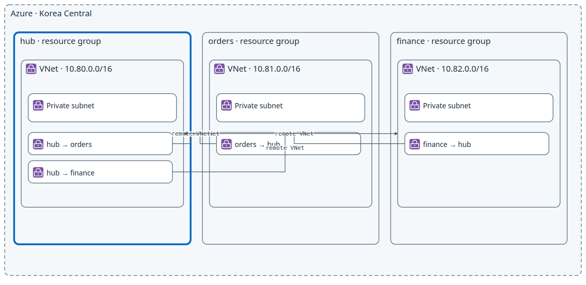
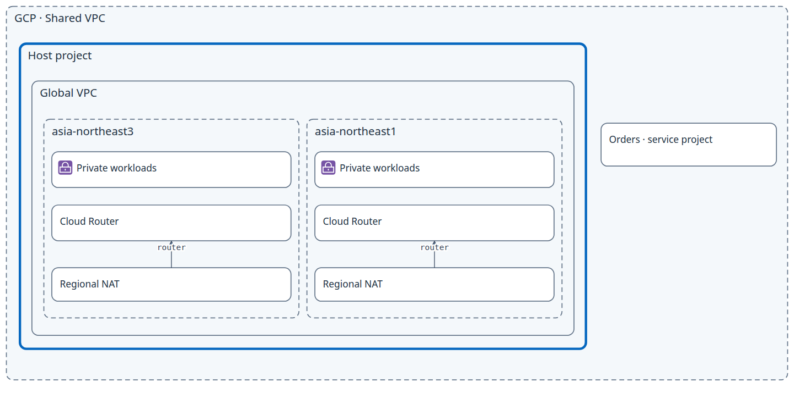
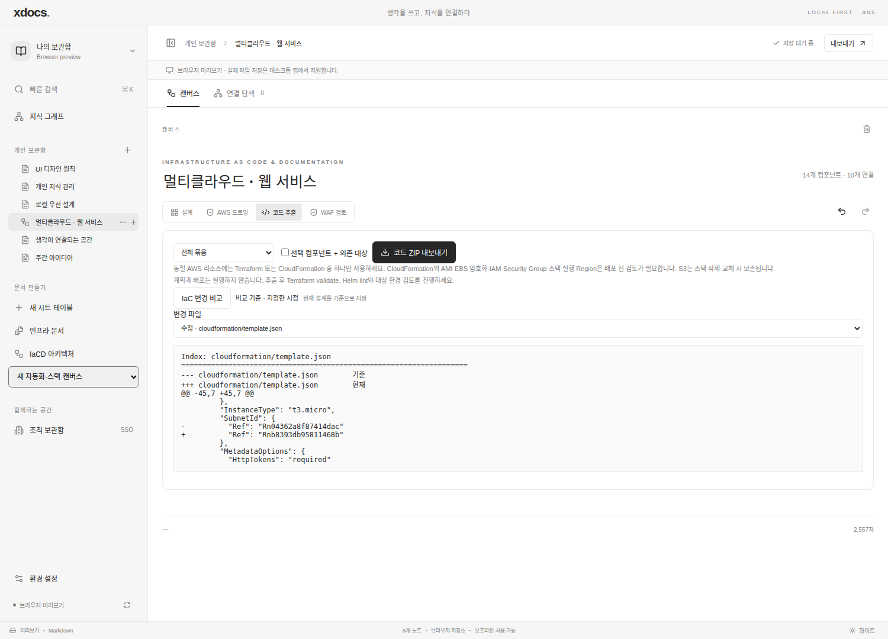
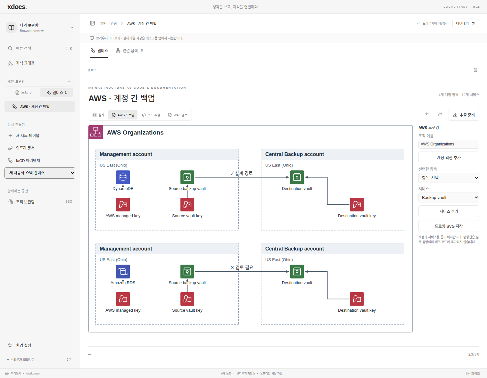

# xdocs

**English** · [한국어](README.ko.md)

A local-first desktop workspace for linked notes, spreadsheets and infrastructure diagrams. Keep Markdown files in your own folder and search them through a SQLite index. You can work offline without an account.

[Download the v0.5.18 development prerelease](https://github.com/uknowpro/xdocs/releases/tag/v0.5.18) for Ubuntu, macOS or Windows. Installers are unsigned and the macOS build is unnotarized.




## Inside a workspace

- **Notes** — Open **새로 만들기** for sheets, canvases and tools, or click the workspace name to switch workspaces. Use the workspace’s + to create a folder and a folder’s + to start a note. Use the arrow beside + to make new xcode sessions the default for that folder. New notes open in the block editor. Edit Markdown or blocks, follow backlinks, browse the graph, restore revisions, attach images and PDFs, import HTML or Markdown, and export Markdown, HTML or PDF. Choose light, gray, dark or system appearance.
- **Sheets** — Import Excel, CSV and TSV. Import a folder of workbooks to preserve the directory tree, with a page per workbook and a tab per sheet. Copy a selection as tab-separated text. [Sheet guide](docs/sheets.md)
- **Infrastructure** — Inventory Terraform/OpenTofu, Kubernetes and Compose resources, inspect relationships and record operational notes. Design nested cloud networks and move between a component and its Terraform declaration. Compare module input and output declarations across two versions using local terraform-docs JSON files. Review local Terraform/OpenTofu plan JSON on the canvas and reuse selected boundaries as workspace templates. Filter template previews by provider and scenario. Edit a resource alongside its live Terraform, follow references in either direction and compare the current file with its opening version. Browse 40 designs covering AWS (9), Azure (19), GCP (10) and multi-cloud (2), including cross-account EFS recovery, Azure firewall routing and a BigQuery batch cutover. Open a card’s reference to highlight both resources, then follow the connection to its Terraform property. The catalog lists required root variables before you start. Export supported components to Terraform, CloudFormation, Helm or Kubernetes manifests. [IaCD guide](docs/iacd.md) · [Infrastructure guide](docs/infrastructure.md)
- **Automation canvases** — Import GitHub Actions, Jenkins Declarative, Ansible and CloudFormation files, edit individual blocks, and embed a linked canvas preview in a note. [Canvas guide](docs/automation-canvas-review.md)
- **xcode** — Chat with a self-hosted model, attach project files and follow streamed replies. Enter the full Chat Completions URL, an optional API token and the model ID to start chatting. Import or edit `settings.json` to reuse a connection and retry settings. Resume interrupted stages in a local workspace. [Session guide](docs/xcode.md) Search job roles and preview a harness before applying it. Fill Word and Excel forms from attached sources, review the values, and save a copy. Repeating Word rows and conditional sections use an optional local python-docx-template installation.
- **Analyzer** — Project scans run offline using the bundled netspector, kubewiser v0.2.0-alpha.10 and Helm executables. Inspect project network paths, Kubernetes manifests and Helm charts. Compare Kubernetes versions and save findings as a linked report for Builder. [Analyzer guide](docs/analyzer.md)
- **Builder** — Assemble review steps around a sheet or note, trace findings to cells or lines, and save results to a child note. Desktop users can connect compatible model endpoints and MCP resources, retry with a saved model profile, and check structured responses for missing evidence. [Builder guide](docs/brainboard-builder.md)
- **Team workspaces** — Connect an organization server for SSO, offline sync, collaborative block editing and per-document editing permissions. [Server setup](docs/server.md)

<details>
<summary>xcode chat and session settings</summary>




</details>

<details>
<summary>Architecture and automation screenshots</summary>

Under **IaCD → 사례 설계**, open the two-zone Seoul egress network, private EKS operations platform or dual-cloud branch routing design. The Azure hub-and-spoke and GCP regional Shared VPC cases include resource-level diagrams and operational review notes. Select a resource in the overview to inspect its Terraform source. Dashed arrows indicate integration work to configure.








</details>

<details>
<summary>Builder and cloud template catalog</summary>


</details>

## Run from source

Use Node.js 24 or newer and a desktop session.

```sh
git clone https://github.com/uknowpro/xdocs.git
cd xdocs
npm ci
npm start
```

Choose a workspace folder when the desktop app opens. For a browser preview, run `npm run dev`. The preview uses browser storage, which is cleared when you remove site data.

## Updates and backups

Keep your workspace outside the application directory. After updating, reopen the same folder to read your Markdown files. The SQLite index can be rebuilt from those files. Migration tests cover v0.1 workspaces and preservation of note IDs. Before upgrading, finish saving, close the app and back up the entire workspace. Signed installer-to-installer upgrades still need validation on user devices.

## Development

```sh
npm test              # Unit and storage tests
npm run build         # Type check and build
npm run test:ui       # Playwright UI tests
npm run test:desktop  # Electron smoke test after building
npm run dist          # Package for the current OS
```

[User and developer guide](docs/guide.md) · [Architecture](docs/architecture.md) · [PolyForm Internal Use License 1.0.0](LICENSE)

You may use, modify and create derivative works for your internal business operations. External distribution requires separate permission.

Earlier MIT grants and third-party licenses continue to apply to their respective code.
