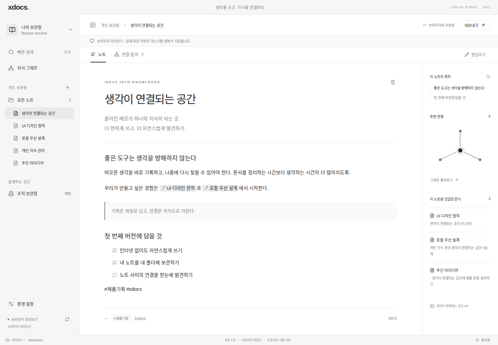
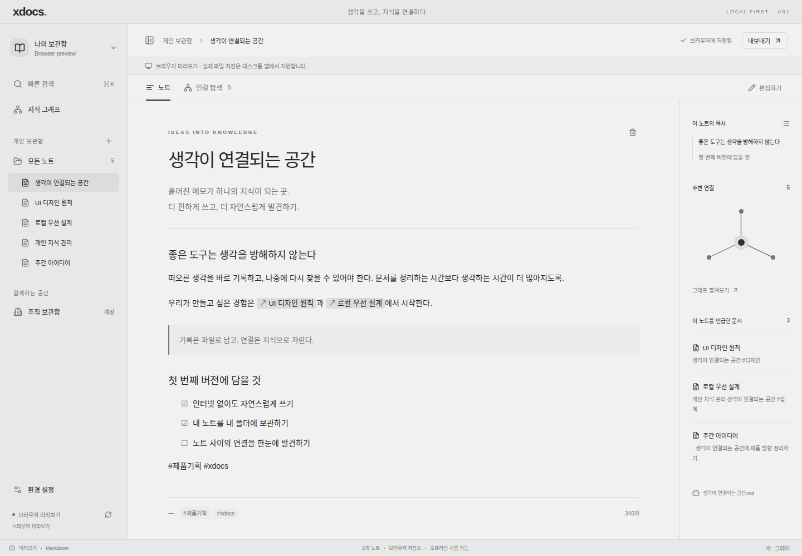

<div align="center">

# xdocs

**생각을 쓰고, 지식을 연결하다.**

로컬 파일 기반의 크로스플랫폼 지식 노트 앱

[시작하기](#빠른-시작) · [주요 기능](#주요-기능) · [개발 로드맵](#로드맵) · [아키텍처](docs/architecture.md)

</div>

---

xdocs는 **노션처럼 편하게 작성하고, 옵시디언처럼 내 파일을 소유하며 노트를 연결하는 경험**을 지향합니다. Markdown 파일을 원본으로 보관하고, SQLite로 검색과 연결 정보를 관리합니다. 개인 보관함은 로그인이나 서버 연결 없이 사용할 수 있습니다.

> **현재 상태: v0.1.0 개발용 알파**
>
> 로컬 저장·Markdown 편집·검색·그래프·내보내기가 구현되어 있습니다. 블록 편집기, 조직 서버, SSO와 동기화는 후속 개발 범위입니다. 현재 편집 방식은 **Markdown 원문 편집 ↔ 읽기 화면** 전환입니다.

## 화면 미리보기

화이트·그레이·다크 테마를 제공하며, 시스템 테마를 따르도록 설정할 수도 있습니다.

### 화이트



<details>
<summary>그레이 테마 보기</summary>



</details>

### 다크


_데모 노트를 사용한 실제 브라우저 미리보기 화면입니다. 데스크톱 앱은 같은 UI에 로컬 파일 저장과 SQLite를 연결합니다._

## 주요 기능

| 영역     | 현재 제공하는 기능                                            |
| -------- | ------------------------------------------------------------- |
| 보관함   | 폴더 선택, 하위 폴더의 Markdown 탐색, 새 노트, `.md` 가져오기 |
| 편집     | Markdown 원문, 읽기 화면, 제목·굵게·할 일·링크·코드 서식 도구 |
| 저장     | 자동 저장, 수동 저장, 종료 전 저장 확인, 외부 수정 충돌 감지  |
| 검색     | SQLite 기반 제목·본문 부분 문자열 검색                        |
| 연결     | `[[노트 제목]]`, ID 기반 링크, 백링크                         |
| 그래프   | 현재 노트 주변·전체 그래프, 노드 선택 후 문서 이동            |
| 내보내기 | Markdown, HTML, PDF                                           |
| 테마     | 화이트, 그레이, 다크, 시스템 설정 및 선택 유지                |
| 삭제     | 원본을 보관함 내 휴지통 폴더로 이동                           |

### 문서 형식별 지원

| 형식     | 가져오기 | 편집·보기             | 내보내기 |
| -------- | -------- | --------------------- | -------- |
| Markdown | 지원     | 원문 편집·읽기        | 지원     |
| HTML     | 예정     | 전용 편집·보기 미지원 | 지원     |
| PDF      | 예정     | 뷰어·첨부·OCR 예정    | 지원     |

## 빠른 시작

### 준비 사항

- **Node.js 24 이상**, npm, Git
- 데스크톱 앱을 실행할 수 있는 그래픽 환경
- 최초 의존성 및 Electron 다운로드를 위한 네트워크 연결
- 한글 표시와 PDF 출력을 위한 한글 폰트

### 설치 및 실행

```sh
git clone https://github.com/uknowpro/xdocs.git
cd xdocs
npm ci
npm start
```

`npm start`는 타입 검사와 프런트엔드 빌드 후 Electron을 실행합니다.

1. **보관함 폴더 열기**에서 기존 Markdown 폴더 또는 빈 폴더를 선택합니다.
2. 왼쪽 보관함의 **+** 버튼으로 새 노트를 만듭니다.
3. **편집하기**에서 내용을 작성하면 자동으로 저장됩니다.
4. `[[다른 노트 제목]]`으로 연결하고 **연결 탐색**에서 그래프를 확인합니다.
5. **환경 설정**에서 테마를, **내보내기**에서 출력 형식을 선택합니다.

개인 보관함은 소스 코드 저장소 밖에 두는 것을 권장합니다. 설치된 앱의 개인 보관함 사용에는 계정이 필요하지 않습니다.

### 브라우저에서 UI 확인

```sh
npm run dev
```

터미널에 표시되는 로컬 주소를 여세요. 브라우저 모드는 데모 노트와 `localStorage`를 사용하는 UI 미리보기입니다. **실제 파일 저장, SQLite, 파일 가져오기는 데스크톱 앱에서 동작합니다.** 브라우저의 PDF 내보내기는 인쇄 대화상자를 사용합니다.

### 단축키

| 작업                | Windows / Linux | macOS   |
| ------------------- | --------------- | ------- |
| 빠른 검색           | `Ctrl + K`      | `⌘ + K` |
| 저장                | `Ctrl + S`      | `⌘ + S` |
| 검색·설정·메뉴 닫기 | `Esc`           | `Esc`   |

## 파일과 데이터

### Markdown이 원본입니다

```text
my-vault/
├── 노트-xxxxxxxx.md
├── 기존폴더/
│   └── 기존노트.md
└── .xdocs/
    ├── index.sqlite       # 재생성 가능한 검색·링크 색인
    └── trash/             # 삭제한 노트 원본
```

앱에서 만든 파일은 다음과 같은 형태입니다.

```markdown
<!-- xdocs:id=550e8400-e29b-41d4-a716-446655440000 -->

# 프로젝트 아이디어

오늘의 생각을 정리합니다.

[[UI 디자인 원칙]]과 연결해 봅니다.
```

기존 Markdown 파일에는 메타데이터를 강제로 추가하지 않습니다. 보관함의 새로고침 버튼을 누르면 파일을 다시 읽고 SQLite 색인을 재생성합니다.

### 링크와 이름 변경

- `[[노트 제목]]`: 제목으로 연결합니다. 제목을 바꾸면 기존 제목 링크는 자동으로 갱신되지 않습니다.
- `[[노트 ID|표시 이름]]`: ID로 연결합니다. 앱에서 생성한 노트는 제목 변경 후에도 ID를 유지합니다.
- 제목이 중복된다면 ID 링크를 사용하세요. 현재 ID는 노트 파일 첫 줄에서 확인할 수 있습니다.
- 앱 외부에서 생성한 노트는 경로 기반 ID를 사용하므로 파일 경로를 변경하면 ID가 바뀝니다.

### 충돌, 휴지통, 백업

- 저장할 때 파일의 이전 버전과 비교합니다. 외부 변경이 발견되면 저장을 중단하고 **충돌 사본 저장**을 제공합니다.
- 외부 변경 자동 감시는 아직 없습니다. 다른 편집기에서 수정했다면 보관함을 새로고침하세요.
- 삭제한 파일은 `.xdocs/trash/`에 보존됩니다. 복원 UI는 아직 없으므로 해당 파일을 보관함으로 옮긴 뒤 새로고침하면 됩니다.
- 백업은 **보관함 폴더 전체**를 복사하세요. SQLite만 복사하면 문서 원본을 백업할 수 없습니다.

저장은 임시 파일 작성·동기화·파일 교체 방식으로 처리합니다. 외부 프로그램의 쓰기를 잠그지는 않으므로 변경 확인과 파일 교체 사이의 동시 쓰기 경쟁을 완전히 차단하지는 못합니다.

## 기술 구성

| 구성                               | 역할                                            |
| ---------------------------------- | ----------------------------------------------- |
| Electron                           | 데스크톱 창, 파일 대화상자, 파일 접근, PDF 출력 |
| React + TypeScript                 | 노트·검색·설정·그래프 UI                        |
| Vite                               | 개발 서버와 프런트엔드 빌드                     |
| Node.js SQLite                     | 로컬 문서·링크 색인과 검색                      |
| Marked + DOMPurify / sanitize-html | Markdown 변환과 HTML 정제                       |
| Playwright + Node.js Test Runner   | UI·데스크톱·파일 저장 검증                      |

```text
React UI
   │ 제한된 preload API
   ▼
Electron main process
   ├── Markdown 파일 (원본)
   ├── SQLite (재생성 가능한 색인)
   └── Markdown / HTML / PDF 내보내기
```

설계 방향과 후속 작업은 [아키텍처 문서](docs/architecture.md)에 정리되어 있습니다.

### 저장소 구조

```text
desktop/                # Electron, 파일 저장, SQLite, IPC
src/                    # React 화면, 테마, Markdown, 그래프
tests/store.test.mjs     # 파일·충돌·색인 테스트
tests/ui/               # 브라우저 UI 테스트
tests/electron-smoke.mjs # 실제 Electron 저장·내보내기 검증
docs/                   # 설계 문서와 화면 이미지
.github/workflows/      # 빌드·테스트 CI
```

## 개발 및 검증

```sh
npm test                         # 저장소 단위 테스트
npm run build                    # 타입 검사 + 프로덕션 빌드
npx playwright install chromium  # UI 테스트 브라우저 설치
npm run test:ui                   # 테마, 편집, 검색, 그래프, HTML 정제
npm run test:desktop              # 실제 Electron 파일 저장 및 내보내기
npm run format                   # 소스와 문서 포맷 정리
```

`test:desktop`은 먼저 `npm run build`를 실행해야 하며 그래픽 환경이 필요합니다. 임시 보관함을 만들어 실제 Markdown 파일 저장, SQLite 생성, Markdown·HTML·PDF 내보내기를 검사합니다. 개인 보관함은 사용하지 않습니다.

초기 구현에서 저장소 테스트 **7개**, 브라우저 UI 테스트 **3개**, Ubuntu 환경의 Electron 저장·내보내기 검증을 통과했습니다. GitHub Actions는 저장소 테스트, 빌드, 브라우저 UI 테스트를 실행하도록 구성되어 있습니다.

## 플랫폼과 패키징

| 플랫폼          | 개발 목표    | 패키징 설정   | 현재 검증 상태                    |
| --------------- | ------------ | ------------- | --------------------------------- |
| Ubuntu 데스크톱 | 로컬 노트 앱 | AppImage, deb | 개발 환경 실행·저장·내보내기 확인 |
| macOS           | 로컬 노트 앱 | dmg           | 실제 OS 검증 및 서명·공증 필요    |
| Windows 10 이상 | 로컬 노트 앱 | NSIS          | 실제 OS 검증 및 서명 필요         |

```sh
npm run dist:dir  # 현재 OS의 실행 디렉터리 패키징
npm run dist     # 현재 OS의 설치 파일 생성
```

출력 위치는 `release/`입니다. 패키징 설정이 포함되어 있지만 서명된 정식 설치 파일을 배포한 단계는 아닙니다. macOS 최소 버전과 CPU 아키텍처별 지원 범위도 릴리스 검증 단계에서 확정합니다.

## 로드맵

- [x] 무채색 데스크톱 UI와 화이트·그레이·다크·시스템 테마
- [x] 로컬 Markdown 파일과 SQLite 색인
- [x] 검색·백링크·노트 그래프
- [x] Markdown·HTML·PDF 내보내기
- [ ] Markdown 호환 블록 편집, 블록 이동, 링크 선택기
- [ ] 첨부파일, PDF 보기, HTML 가져오기
- [ ] 외부 파일 변경 감시, 휴지통 복원 UI, 변경 이력
- [ ] 대규모 보관함용 검색·그래프 성능 개선
- [ ] PostgreSQL 기반 조직 보관함과 사용자·문서 권한
- [ ] OIDC 기반 SSO, 필요에 따른 SAML 연계
- [ ] 오프라인 변경 대기열, 서버 동기화와 충돌 해결
- [ ] 실시간 협업 및 Redis 기반 접속 상태·이벤트 전달
- [ ] 운영체제별 설치·업데이트·서명 검증

**조직 연결의 설계 원칙:** 개인 보관함은 로컬 파일을, 공용 보관함은 서버를 원본으로 삼습니다. Redis는 문서 원본 저장소가 아닌 선택적 캐시·이벤트 계층으로 계획합니다. 현재 서버 연결과 SSO는 구현되지 않았으며 자격증명을 입력받지 않습니다.

## 현재 제한 사항

- 블록 WYSIWYG, 실시간 공동 편집, 클라우드 동기화는 아직 없습니다.
- 검색은 부분 문자열 방식이며 FTS와 페이지네이션은 후속 범위입니다.
- 그래프는 최대 60개 노트를 표시합니다.
- 5 MB 초과 파일, 숨김 폴더, 심볼릭 링크, 20단계 초과 하위 폴더는 색인에서 제외됩니다.
- 내보내기는 문서 본문 기준입니다. 노트 링크 변환과 첨부파일 묶음 내보내기는 아직 지원하지 않습니다.
- Markdown 이미지 표시와 원격 리소스 자동 요청을 제한합니다. 외부 링크를 여는 기능도 아직 제공하지 않습니다.
- PDF는 운영체제에 설치된 폰트를 사용합니다.

## 보안과 저장소 관리

Electron은 `sandbox`와 `contextIsolation`을 사용하고, 렌더러의 Node 접근·임의 탐색·새 창·권한 요청을 차단합니다. 문서 HTML은 표시·내보내기 전에 정제합니다.

`.gitignore`는 의존성, 빌드·테스트 결과, 환경변수, 인증서·키, SQLite 파일, `.xdocs/`, `vault/`, `vaults/`, `local-data/`를 제외합니다. **임의 위치의 모든 Markdown 노트까지 자동으로 제외하는 것은 아닙니다.** 개인 보관함은 저장소 밖에 두고 커밋 전에 포함 파일을 확인하세요.

## 기여 및 라이선스

버그는 [Issues](https://github.com/uknowpro/xdocs/issues)에 운영체제·실행 방법·재현 순서와 함께 남겨 주세요. 개인 노트나 인증 정보가 포함되지 않은 최소 예제를 사용해 주세요. 변경 후에는 관련 테스트와 `npm run build`를 실행해 주세요.

[MIT License](LICENSE)
