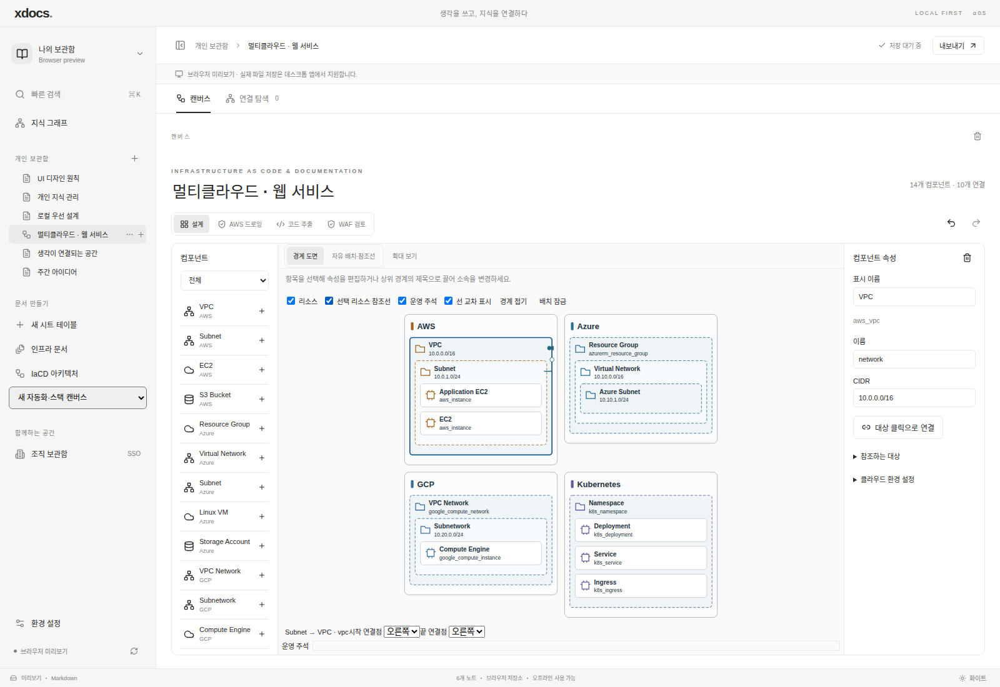

# IaCD — 시각적 아키텍처와 코드

현재 `main` 개발분에 구현된 기능입니다. 기존 v0.4.0-alpha.1 설치 릴리스에는 포함되지 않습니다.

사이드바 **IaCD 아키텍처**에서 빈 캔버스·멀티클라우드 예제·Terraform 가져오기를 선택합니다. 컴포넌트를 클릭하거나 끌어 배치하고, 속성에서 연결 대상을 고르거나 **대상 클릭으로 연결**을 사용합니다. 화살표는 **참조하는 컴포넌트 → 참조 대상** 방향입니다. 위치 이동·키보드 방향키·확대/축소·맞춤·그룹별 정렬·실행 취소/다시 실행을 지원합니다.

## 구현된 컴포넌트

| 범위                   | 지원 컴포넌트                                                      |
| ---------------------- | ------------------------------------------------------------------ |
| AWS                    | VPC, Subnet, EC2, S3                                               |
| Azure                  | Resource Group, Virtual Network, Subnet, Linux VM, Storage Account |
| GCP                    | VPC Network, Subnetwork, Compute Engine, Cloud Storage             |
| Kubernetes             | Namespace, Deployment, Service, Ingress, ConfigMap, PVC            |
| Azure Verified Modules | Resource Group, Virtual Network, Private Storage                   |

클라우드 전체 서비스 카탈로그가 아닙니다. 예를 들어 관리형 Kubernetes 클러스터, load balancer, IAM/RBAC 전체, 방화벽·라우팅·NAT·모니터링 전체는 자동 생성하지 않습니다. Kubernetes 컴포넌트는 별도 클러스터를 대상으로 하며 AWS/Azure/GCP VM과 연결한다고 클러스터가 생기지 않습니다. 선은 지원하는 형식의 실제 참조 필드에 대응하며 임의의 두 컴포넌트를 연결해 배포 의미를 만들어내지 않습니다.

## 추출

**코드 추출**에서 전체·Terraform·CloudFormation·manifest·Helm을 선택합니다. 선택 컴포넌트만 추출할 때는 참조하는 의존 대상도 포함합니다. 선택 형식과 맞지 않는 컴포넌트는 제외 안내를 표시합니다. 필수값·연결·숫자 범위·이름·일부 CIDR 검증 실패 시 추출을 막습니다. 공급자의 모든 런타임 제약을 검증하지는 않습니다.

| 파일                                                                      | 내용                                                                              |
| ------------------------------------------------------------------------- | --------------------------------------------------------------------------------- |
| `terraform/main.tf.json`                                                  | Terraform이 직접 읽는 공식 JSON 구성. 새 리소스와 provider·모듈 참조              |
| `terraform/terraform.tfvars.example`                                      | Azure 구독·GCP 프로젝트 ID 예제. 인증정보 없음                                    |
| `cloudformation/template.json`                                            | AWS VPC·Subnet·EC2·S3의 CloudFormation 구성, `Ref` 연결, S3 삭제·교체 시 Retain   |
| `manifests/*.yaml`                                                        | 컴포넌트별 Kubernetes 리소스                                                      |
| `chart/Chart.yaml`, `chart/values.yaml`, `chart/templates/resources.yaml` | Helm v2 application chart. `values.resources.<컴포넌트ID>`의 리소스 정의를 렌더링 |
| `architecture.json`, `architecture.svg`                                   | 편집 모델과 정적 다이어그램                                                       |
| `WELL_ARCHITECTED.md`, `README.md`                                        | 설계 검토 기록·생성 범위·사용 안내                                                |

Terraform과 CloudFormation은 **같은 AWS 리소스에 중복 적용하지 않습니다.** Kubernetes manifest와 Helm도 같은 리소스에 중복 적용하지 않습니다. Helm은 리소스 정의를 values로 제공하며 임의 입력을 `tpl`로 실행하지 않습니다. 네임스페이스 이름은 입력값 그대로 유지하므로 설치할 release·namespace·기존 리소스 소유권을 검토하세요.

Terraform은 AWS `~> 6.0`, AzureRM `~> 4.0`, Google `~> 7.0`, AVM 사용 시 AzAPI `~> 2.12`를 명시합니다. 새 클라우드 리소스는 Terraform 1.5 이상, AVM은 1.10 이상·2.0 미만을 요구합니다. 실제 프로젝트에서는 `terraform init` 후 생성된 lock 파일을 버전 관리하세요. 인프라 명령·인증·plan/apply·스택 생성은 xdocs가 실행하지 않습니다.

## 아키텍처 사례 카탈로그

AWS 16종, Azure 19종, GCP 17종, 멀티클라우드 3종을 제공한다. 검색은 이름, Terraform 리소스 유형, 검토 주제를 대상으로 한다. 사례를 선택하면 검토할 설계 질문이 나오며 캔버스의 WAF 운영 검토에서도 다시 읽을 수 있다.

| 공급자 | 사례 | 검토할 설계 결정 |
| --- | --- | --- |
| AWS | EFS 백업과 복원 훈련 | 운영 계획의 copy action에서 보관 Vault와 KMS 키를 따라간 뒤 격리된 복원 결과를 검증 |
| Azure | 허브·스포크 NAT와 방화벽 | 스포크 송신 경로 버튼으로 subnet-private, UDR, 방화벽, 정책, 규칙의 Terraform 선언을 순서대로 확인 |
| GCP | 일별 배치 결과 대조 | 동일 입력에 두 반올림 방식을 적용하고 주문별 합계가 다르면 기존 결과 게시 |
| AWS | 멀티계정 랜딩존 감사 | 조직 추적에서 별도 보관 계정으로 로그를 전달하고 정책 장애 후 수신을 확인 |
| Azure | 한국·일본 무상태 웹 서비스 | 주 리전의 HTTPS 상태 점검 실패와 DNS 캐시 만료 후 복구 시간 측정 |
| 멀티클라우드 | 지점망 이중 라우터 | 한 장비가 중단될 때 AWS 및 GCP로 가는 독립 BGP 경로 확인 |
| Azure | 사업부별 AVM 사설 데이터 구역 | 수집·재무·감사별 VNet, Private Endpoint, 저장소 복제 정책 |
| GCP | 멀티테넌트 GKE, Interconnect 위의 HA VPN | 테넌트별 권한 분리, 회선과 터널의 장애 경계 |
| 멀티클라우드 | AWS–GCP, Azure–GCP HA VPN | 양쪽 게이트웨이, 터널, BGP 피어가 연결되는 방식 |

원본 기반 사례에는 지정한 커밋의 해당 디렉터리 최상위 Terraform 파일과 라이선스가 포함된다. 배포에 필요한 함수 패키지·컨테이너 이미지·하위 모듈·환경별 입력 등은 사례별 원본에서 확인한다. 기존에 만든 캔버스는 생성 시점의 설계를 문서에 저장하므로 카탈로그 교체 후에도 같은 내용을 연다. [원본 디렉터리 및 커밋 목록](../catalog/sources.json)

## Terraform → 다이어그램

같은 모듈 디렉터리의 `.tf`·`.tf.json` 여러 파일을 선택합니다. resource·data·module 선언을 노드로 만들고 표현식과 depends_on의 정적 참조를 연결합니다. 원본은 파일명·내용을 그대로 저장합니다. 알 수 없는 리소스도 일반 노드로 표시합니다.

- 사용자 확인 후 원본을 Markdown 노트의 버전 1 `xdocs-architecture` 블록에 보관합니다. 일반 노트처럼 SQLite 색인·이력·조직 동기화가 적용됩니다. **원본의 주석·변수 기본값·문자열에는 비밀정보가 있을 수 있습니다. 조직 보관함에서는 원본도 동기화됩니다.** 이전 인프라 요약 가져오기와 달리 원본을 제거하지 않습니다.
- 원본 리소스의 배치·표시 이름은 편집할 수 있습니다. 카탈로그에 대응하는 문자열 속성을 편집하면 변경값을 `zz_xdocs_override.tf.json`으로 추출합니다. 원본에 override 파일이 있으면 편집한 override 추출을 차단합니다. 원본 리소스 삭제와 임의 표현식·중첩 블록 재작성은 하지 않습니다.
- 변수·함수·provider·모듈을 평가하지 않습니다. count/for_each는 선언 하나로 표시하며 모듈 내부를 내려받거나 펼치지 않습니다. 일반 파일 가져오기는 선택한 파일만 읽습니다. 폴더 가져오기는 아래 범위의 로컬 모듈 설정도 함께 읽습니다.
- 가져온 문서의 Terraform 추출은 선택과 관계없이 가져온 파일 전체를 포함합니다. 직접 소속 참조를 변경하면 보관된 사본에서 해당 주소만 바꾸며, 디스크의 입력 파일은 그대로 유지합니다. 가져온 원본과 새 클라우드 리소스는 provider·변수 충돌 방지를 위해 별도 아키텍처 노트로 관리합니다. 가져온 Terraform을 CloudFormation으로 변환하지 않습니다.
- 원본 파일은 총 2 MB·100개, 노드는 300개, 저장 모델은 4 MB, 구문 분석은 20초 제한입니다. 파일명은 영문·숫자·점·밑줄·하이픈을 지원합니다. 중복 선언·파일명 충돌을 거부합니다. 대규모 프로젝트는 모듈별로 나누어 가져오세요.

## Azure AVM과 Well-Architected

공식 Registry 및 해당 tag의 입력·출력을 확인해 고정했습니다(2026-11-18).

| 컴포넌트        | 공식 모듈                                                                                                                                  | 버전   |
| --------------- | ------------------------------------------------------------------------------------------------------------------------------------------ | ------ |
| Resource Group  | [Azure/avm-res-resources-resourcegroup/azurerm](https://registry.terraform.io/modules/Azure/avm-res-resources-resourcegroup/azurerm/0.5.0) | 0.5.0  |
| Virtual Network | [Azure/avm-res-network-virtualnetwork/azurerm](https://registry.terraform.io/modules/Azure/avm-res-network-virtualnetwork/azurerm/0.23.0)  | 0.23.0 |
| Private Storage | [Azure/avm-res-storage-storageaccount/azurerm](https://registry.terraform.io/modules/Azure/avm-res-storage-storageaccount/azurerm/0.11.0)  | 0.11.0 |

AVM Private Storage는 공개망·공유키 사용을 끄고 TLS 1.2, 기본 ZRS, Blob Private Endpoint 및 `privatelink.blob.core.windows.net` DNS·VNet 연결을 생성합니다. VNet에는 Private Endpoint용 subnet을 포함합니다. 텔레메트리는 꺼진 구성으로 내보냅니다. AVM 최신 버전 자동 추적은 하지 않습니다. 리소스가 제공하는 확장 기능 전부를 UI에 노출하지 않으며, RBAC·로그·백업·다른 스토리지 서비스 endpoint는 별도 검토해야 합니다. ZRS 지원 지역·SKU·쿼터와 실제 Private DNS 연결성도 실제 환경에서 확인해야 합니다.

**AVM 사용 자체가 워크로드의 WAF 준수나 인증을 의미하지 않습니다.** WAF 검토 화면은 신뢰성·보안·비용 최적화·운영 우수성·성능 효율성별 근거·담당자·후속 작업을 기록하며 자동 합격 점수를 부여하지 않습니다. Azure Landing Zone 전체나 WAF 인증 자동화 기능으로 해석하지 않습니다.

## 검증과 참고

생성 코드는 테스트 구성에서 Terraform CLI의 구문·provider·AVM 스키마 검증, Helm lint·template, CloudFormation lint를 수행합니다. 클라우드 plan/apply, Kubernetes 서버 dry-run, Azure 지역·권한·실제 WAF 평가·운영 비용은 검증하지 않았습니다.

참고: [ArchFormation](https://archformation.com/), [Brainboard](https://www.brainboard.co/), [사용자 제공 Brainboard 소개](https://kschoi728.tistory.com/26), [Terraform JSON 문법](https://developer.hashicorp.com/terraform/language/syntax/json), [Terraform override](https://developer.hashicorp.com/terraform/language/files/override), [AVM 소개](https://azure.github.io/Azure-Verified-Modules/), [Microsoft WAF](https://learn.microsoft.com/azure/well-architected/), [Helm charts](https://helm.sh/docs/topics/charts/), [CloudFormation 구조](https://docs.aws.amazon.com/AWSCloudFormation/latest/UserGuide/template-anatomy.html).

외부 도구의 코드나 디자인 자산을 복제하지 않았습니다. Terraform 파서는 [CDK Terrain hcl2json](https://github.com/open-constructs/cdk-terrain/tree/main/packages/%40cdktn/hcl2json)을 로컬 작업 스레드에서 사용합니다.

## AWS 계정·리전 드로잉

**IaCD 아키텍처 → AWS 백업 드로잉 예제**로 시작하거나 기존 아키텍처에서 **AWS 드로잉** 탭을 엽니다. 계정 영역마다 리전을 표시하며 같은 계정을 다른 리전에 다시 그릴 수 있습니다. 계정과 서비스를 끌어 위치를 바꾸고 속성에서 이름·리전·소속 계정을 편집합니다. 서비스 선택 후 연결 대상과 방향선을 추가하고 선을 선택해 라벨을 입력합니다. 계정을 삭제하면 소속 서비스와 관련 선도 함께 삭제되며 실행 취소로 복원할 수 있습니다.

예제의 체크·엑스는 편집 가능한 설명입니다. 실제 백업 가능 여부나 IAM·KMS 정책 검증 결과를 의미하지 않습니다. 서비스 심볼은 xdocs 자체 도형입니다. 드로잉은 SVG로 저장되며 코드 ZIP에도 포함됩니다. Terraform·CloudFormation 생성은 **설계** 탭의 배포 컴포넌트를 사용합니다.

노트의 **캔버스 미리보기 삽입**은 별도 줄에 `![[캔버스 ID]]`를 기록합니다. 문서를 복제하지 않으므로 원본의 다음 저장분이 미리보기에 반영됩니다. 일반 위키 링크 `[[캔버스 ID|표시 이름]]`도 지원합니다.

## 멀티클라우드 경계 도면

**설계 → 경계 도면**에서 같은 공급자 안의 소속 관계를 확인합니다. AWS VPC에는 서브넷이, 서브넷에는 EC2가 들어갑니다. S3 버킷은 VPC 외부에 표시됩니다. Azure는 리소스 그룹·VNet·서브넷, GCP는 네트워크·서브네트워크, Kubernetes는 네임스페이스를 경계로 사용합니다. 네임스페이스 내 Service와 Deployment는 같은 수준에 놓입니다.

작성한 컴포넌트를 호환되는 상위 경계의 제목으로 끌거나 속성의 참조 대상을 바꾸면 도면과 생성 코드가 함께 바뀝니다. **자유 배치·참조선**에서 저장된 좌표와 일반 의존 관계를 볼 수 있습니다. 코드 ZIP에는 경계 도면 `architecture.svg`와 참조선 도면 `references.svg`가 포함됩니다. 예제 EC2의 AMI ID를 비워두면 생성한 Terraform과 CloudFormation에서 배포 시 값을 받습니다.

Terraform 가져오기는 지원 속성의 직접 참조에서 소속을 판별합니다. 변수·조건식·단순 depends_on·해석할 수 없는 모듈 내부는 소속을 추정하지 않습니다. 이전 버전에서 가져온 문서에 소속 정보가 없으면 원본 Terraform을 새 캔버스로 가져와 확인할 수 있습니다.

**선택 리소스 참조선**을 켜면 현재 리소스가 참조하거나 현재 리소스를 참조하는 항목만 화살표와 목록으로 볼 수 있습니다. **코드 추출 → IaC 변경 비교**에서는 현재 선택한 형식·범위에 대해 추가·수정·삭제된 파일을 확인합니다. 기준은 페이지를 열었을 때의 설계이며 **현재 설계를 기준으로 지정**하면 이후 편집만 비교합니다. 페이지를 다시 열면 기준도 새로 시작합니다. 비교에는 Terraform 실행이나 클라우드 자격증명이 필요하지 않습니다.

경계 도면에서 리소스를 끌면 가능한 경계가 강조되고 포인터 아래의 대상 이름이 표시됩니다. 가져온 Terraform은 소속 속성이 같은 모듈의 리소스나 데이터 소스를 직접 가리킬 때 대상을 바꿀 수 있습니다. 예를 들어 EC2를 다른 서브넷으로 옮기면 추출한 파일의 `subnet_id`가 바뀌고 이를 다시 가져오면 새 서브넷 안에 표시됩니다. 변수·조건식으로 정한 소속은 원문을 유지합니다. 예전에 가져온 캔버스에서 원문 참조를 편집하려면 원본 파일을 새 캔버스로 다시 가져오세요.

경계를 선택해 접으면 내부 항목 수가 표시되고 외부 참조선은 접힌 경계까지 이어집니다. 흰색 연결점은 선의 꺾임을 옮기고, 파란색 연결점은 소속 참조의 대상을 바꿉니다. **배치 잠금**은 선택한 리소스의 이동과 소속 변경을 막습니다. 경계 접기, 꺾임점, 잠금, 운영 주석과 레이어 표시는 캔버스에 저장되며 생성하는 IaC에는 영향을 주지 않습니다.

참조 목록에서 각 선의 시작·끝 연결점을 위·아래·왼쪽·오른쪽으로 지정할 수 있습니다. **선 교차 표시**를 켜면 교차하는 선에 작은 반원을 그립니다.

## 리소스 찾기와 경계 안에서 추가

캔버스에 포커스를 둔 상태에서 `/`를 누르거나 **리소스 찾기**에 이름, 유형 또는 Terraform 주소를 입력합니다. 방향키로 결과를 선택하고 Enter로 속성을 엽니다. 접힌 상위 경계는 검색 중에 펼쳐지며, 검색만 해서는 저장된 도면이나 추출 코드가 바뀌지 않습니다. 좁은 창에서는 속성 패널이 도면 위에 열립니다. Esc 또는 **속성 닫기**를 누르면 도형으로 포커스가 돌아갑니다.

서브넷 같은 경계를 선택한 뒤 `+`를 누르면 그 안에 배치할 수 있는 유형을 검색합니다. EC2를 추가하면 해당 서브넷 참조까지 한 번에 설정됩니다. 속성의 소속 선택기로 기존 리소스를 옮길 수 있습니다. 가져온 Terraform은 편집 가능한 직접 참조에서만 소속을 바꿀 수 있습니다.

**AWS 구성요소 찾기**에서 계정 이름, 리전, 서비스 종류, 항목 이름을 함께 검색할 수 있습니다. 자동화·CloudFormation 캔버스에서는 **블록 찾기**에서 Job, Stage, Task 또는 논리 ID를 선택하면 해당 원문 범위로 이동합니다. 작성 중인 원문을 적용하거나 취소하면 다른 블록으로 이동할 수 있습니다.

가져온 리소스를 선택하면 **Terraform 배치 근거**에서 확인된 경계와 직접 참조의 파일명·필드를 볼 수 있습니다. 변수나 모듈 출력으로 소속을 확정할 수 없으면 새로 가져온 구성에서는 파서가 읽은 식을 Terraform JSON 표현으로 표시합니다. **참조하는 대상**을 열고 주소를 누르면 그 리소스나 모듈의 속성으로 이동합니다. 이전 캔버스에서 저장하지 않은 간접 표현식은 원문에서 확인하거나 원본을 새 캔버스로 가져와 확인하세요.

[동일 Terraform 예제로 비교한 경계 배치·의존선·왕복 변환](terraform-graph-comparison.md)

### Azure 및 AWS의 반복 네트워크 구성

AzureRM을 가져오면 리소스 그룹 → VNet → 서브넷을 직접 참조로 배치합니다. Linux·Windows VM에서 NIC 하나를 직접 지정하고 그 NIC의 단일 IP 구성이 서브넷 하나를 직접 가리키면 VM의 속성에 NIC 경유 경로가 표시됩니다. NIC 버튼으로 해당 선언을 열 수 있습니다. 여러 NIC·여러 IP 구성·동적 블록에서는 VM의 소속을 미확정으로 둡니다.

AWS EC2의 `subnet_id`, Azure NIC의 `ip_configuration.subnet_id`, Azure VM의 단일 NIC가 반복 선언을 `[each.key]`로 가리키면 속성 및 선택 리소스의 참조선에서 **선언 참조**를 확인할 수 있습니다. 도면은 각 키의 실제 인스턴스를 펼치지 않습니다. 기존 캔버스에 NIC의 배치 정보가 없으면 원본 Terraform을 새 캔버스로 가져옵니다. [Azure 예제](../tests/fixtures/indexed-placement/azure/main.tf) · [AWS 예제](../tests/fixtures/indexed-placement/aws/main.tf)

### GCP VPC·서브넷·Compute Engine VM

GCP Terraform을 가져오면 `google_compute_subnetwork.network`의 직접 참조를 따라 서브넷을 VPC 안에 표시합니다. VM에 NIC가 하나 있고 `network_interface.subnetwork`가 서브넷을 직접 참조하면 VM도 해당 서브넷 안에 표시합니다. 예제에서는 `self_link`를 사용합니다. 속성에서 다른 서브넷으로 옮기면 추출본의 직접 참조 주소가 바뀝니다.

- `google_compute_subnetwork.per_key[each.key].self_link`는 서브넷 선언에 연결하고, 속성에서 키별 인스턴스의 소속을 미확정으로 표시합니다.
- 여러 NIC가 서로 다른 서브넷에 연결되면 VM을 하나의 서브넷에 넣지 않습니다. **Terraform 배치 근거**에 각 NIC의 순서와 가져온 네트워크·서브넷 식을 표시합니다. 동적 NIC 블록은 Terraform 평가가 필요한 구성으로 표시합니다.
- 기존 캔버스에 NIC별 근거가 저장되지 않았다면 원본을 새 캔버스로 가져와 확인합니다.

[Google provider 7.46.2 검증 예제](../tests/fixtures/indexed-placement/gcp/main.tf) · [가져오기·이동·재추출 테스트](../tests/indexed-placement.test.mjs)

### 로컬 모듈 출력 추적 (main 개발분)

**로컬 모듈 포함 폴더 가져오기**에서 루트 Terraform 프로젝트를 선택합니다. 루트와 그 루트가 `source = "./modules/network"`처럼 직접 호출하는 하위 디렉터리의 `.tf`·`.tf.json`을 미리보기에 표시하고 노트에 보관합니다. ZIP에서도 이 파일들의 상대 경로를 유지합니다. 외부·상위 경로·원격 모듈, 모듈 안에서 호출하는 추가 모듈 및 템플릿 등 별도 자산은 사용자가 따로 제공합니다.

배치 속성이 `module.network.subnet_id`를 직접 참조하면 **Terraform 배치 근거 → module.network.subnet_id · output 선언**을 펼칩니다. 출력 식과 파일 원문을 볼 수 있습니다. 출력이 `var.input`을 그대로 전달하고 호출 인수가 루트 리소스를 직접 가리키면 주소를 눌러 캔버스에서 이동합니다. 출력이 모듈 내부 리소스를 직접 가리키면 해당 선언의 파일을 엽니다. 조건·함수 표현식은 원문을 확인하며 실제 인스턴스를 추정하지 않습니다. 이 탐색은 배치 편집이나 Terraform 평가를 수행하지 않습니다.

### 캔버스에서 Terraform 검토하기

넓은 화면에서는 속성·설계 이슈·Terraform 뷰어가 도면 오른쪽에 표시됩니다. 좁은 화면에서는 도면 아래에서 코드를 확인합니다. 파일을 선택하면 내보내기에 쓰이는 코드가 보이며, **현재 파일 복사**로 전체 내용을 복사하거나 **변경 줄 보기**로 페이지를 열었을 때와 비교할 수 있습니다. 새 설계는 Terraform JSON을 생성합니다. 가져온 HCL은 원본을 보존하며 지원되는 속성 변경은 오버라이드 파일에서 확인합니다.

리소스를 선택하고 **연결 집중 보기**를 켜면 연결된 리소스와 상위 경계가 강조됩니다. 속성에서 들어오거나 나가는 참조를 따라 이동하고 **설계 이슈**에서 해당 리소스를 바로 열 수 있습니다. 템플릿 카탈로그는 공급자·업무 시나리오·편집 방식·검색어를 함께 적용합니다.

**변경 영향**은 페이지를 열었을 때를 기준으로 직접 수정한 리소스, 그 리소스를 직접 참조하는 항목, 연결·해제된 참조와 변경된 Terraform 파일을 표시합니다. 리소스 이름을 누르면 속성을 열고, 파일명을 누르면 변경 줄을 표시합니다. 템플릿 선택 화면에서 **구성도 확대 미리보기**를 열면 페이지를 만들기 전에 배율을 조절하고 경계·리전 정보와 설계 설명을 읽을 수 있습니다.

### 로컬 실행 계획 검토

캔버스의 **Terraform plan 검토**에서 Terraform 또는 OpenTofu의 `show -json`으로 만든 plan JSON을 엽니다(최대 32 MiB). 작업 배열에 생성과 삭제가 함께 있으면 교체로 표시합니다. 리소스를 선택하면 변경 속성과 적용 후 결정되는 값을 확인할 수 있습니다. 변경 전후 어느 쪽이든 민감 표시가 있는 속성은 양쪽 모두 가립니다. 계획 파일은 열린 캔버스의 메모리에서만 읽습니다. 모듈 내부처럼 주소를 도면에 대응시킬 수 없는 항목도 목록에서 확인할 수 있습니다.

모듈 경로와 작업을 고르고 인스턴스 주소를 검색하면 같은 선언의 여러 인스턴스를 구분할 수 있습니다. 상단 건수는 계획 전체 기준입니다. 교체 항목을 펼치면 계획이 제공한 속성 경로와 사유를 표시합니다. 검토할 항목을 체크하고 확인할 사항을 한 줄씩 입력한 뒤 **검토 노트 저장**을 누르세요. 블록 노트에는 선택 항목, 도면에서 직접 참조하는 리소스, 체크리스트와 원본 캔버스 링크가 들어갑니다. 민감 값은 노트에서도 가려집니다.

가져온 설계의 **Terraform 편집 범위**를 펼치면 파일별로 편집 가능한 속성, 배치 참조, 원문으로 보존하는 선언과 미해석 참조를 볼 수 있습니다. 이전 버전에서 가져온 설계의 세부 선언 목록은 원본을 다시 가져올 때 생성됩니다.

### 설계 일부 재사용

직접 만든 캔버스에서 경계를 선택하고 **워크스페이스 설계 템플릿 → 선택 영역 저장**을 누르면 하위 컴포넌트가 함께 workspace 페이지에 저장됩니다. 다른 캔버스에서 해당 템플릿을 선택하면 같은 이름과 외부 참조를 미리 확인할 수 있습니다. 외부 연결을 지정하고 삽입하면 내부 리소스에는 새 ID가 부여됩니다. 가져온 Terraform 파일은 원문 보존을 위해 이 조합 기능의 대상에서 제외됩니다.

삽입 미리보기에서 표시 이름·배포 이름·CIDR·외부 참조를 수정할 수 있습니다. AWS·Azure·GCP 서브넷은 같은 네트워크 안에서 기존 서브넷 및 함께 삽입하는 서브넷과 IPv4 대역이 겹치는지 검사합니다. 취소하면 도면을 유지하고, 삽입 후에는 한 번의 실행 취소로 함께 추가한 구성요소를 제거합니다.

### 실행 계획에서 모듈 찾기와 서브넷 점검

실행 계획의 인스턴스를 펼치고 **도면에서 모듈 보기**를 누르면 해당 루트 모듈 호출로 이동합니다. 프로젝트 폴더로 함께 가져온 직접 하위 모듈은 **선언 열기**로 해당 파일과 선언을 확인할 수 있습니다. 원격 모듈과 더 깊은 호출은 가져온 범위의 모듈 위치까지 표시합니다. 예전 캔버스에 선언 정보가 없으면 프로젝트 폴더를 다시 가져와 확인하세요.

**설계 이슈**는 같은 네트워크에 배치된 서브넷의 IPv4 대역을 비교합니다. 겹치는 두 서브넷은 각각 눌러 수정할 수 있습니다. 네트워크나 CIDR을 수정하면 즉시 다시 검사합니다. 가져온 Terraform은 네트워크 참조와 주소가 확인되는 선언을 검사하며 변수로 결정되는 대역은 실제 값으로 추정하지 않습니다.

xdocs에서 가져온 원본의 지원 속성을 수정한 뒤 내보낸 Terraform 폴더는 다시 가져와 편집할 수 있습니다. 원본 파일과 로컬 모듈 경로를 보존하며, xdocs가 생성한 변경 파일은 동일한 내용으로 재생성되는 경우에 복원합니다.

### 템플릿의 대표 참조 확인

카드를 선택하고 **필수 입력과 준비 사항**을 펼치면 루트 모듈에서 기본값을 지정하지 않은 변수와 운영 전제를 볼 수 있습니다. **참조 열기**는 해당 템플릿으로 페이지를 만들고 두 리소스, 연결선, 상위 네트워크 경계를 강조합니다. 연결선을 누르거나 **Terraform 속성 보기**를 선택하면 원문 줄이 강조됩니다. 서로 다른 속성이나 줄에서 같은 연결을 참조하면 원하는 위치를 선택하세요. **전체 도면 보기**로 강조를 해제합니다.

지원되는 배치 참조를 변경하면 **변경 영향**에서 직전 배치의 이전·새 대상과 Terraform 변경 줄을 함께 확인할 수 있습니다. 아키텍처 실행 취소는 해당 편집을 도면과 코드에 함께 반영합니다.
