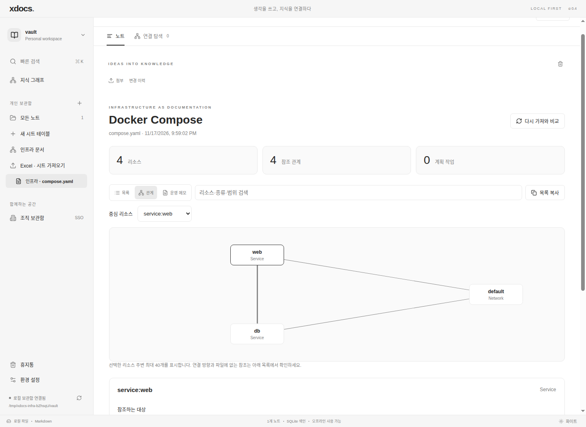

# 인프라를 문서로 관리하기

사이드바의 **인프라 문서 → 파일 선택 → 인프라 노트 생성**을 사용합니다. 브라우저 미리보기에서는 **예제로 살펴보기**를 사용할 수 있습니다.



## 지원 범위

| 입력                              | 문서화하는 내용                                                                               |
| --------------------------------- | --------------------------------------------------------------------------------------------- |
| Terraform / OpenTofu `show -json` | 리소스 주소·종류, 모듈, 허용 속성, 구성 참조, 계획 작업                                       |
| Terraform `.tf.json`              | resource 블록의 이름·종류와 명시적 depends_on                                                 |
| Kubernetes YAML/JSON              | 여러 문서·List, 종류·이름·namespace, owner·Service selector·Secret/ConfigMap/PVC·Ingress 참조 |
| Docker Compose YAML/JSON          | 서비스·네트워크·볼륨·Secret/Config 이름, depends_on 및 명명된 참조                            |

Terraform/OpenTofu에서는 사용자가 생성한 JSON을 가져옵니다. xdocs가 명령을 실행하지 않습니다.

```sh
terraform show -json plan.tfplan > infrastructure.json
```

현재 상태는 `terraform show -json > infrastructure.json` 또는 `tofu show -json > infrastructure.json`으로 내보낼 수 있습니다. JSON에는 민감한 값이 평문으로 포함될 수 있으므로 원본을 공유하거나 저장소에 커밋하지 마세요. xdocs는 원본을 첨부하지 않고 허용 필드의 요약만 저장합니다.

HCL `.tf` 직접 해석, 변수·모듈·provider 평가, Compose 변수 치환·include·extends, Helm/Kustomize 렌더링, 실시간 클라우드 조회·배포는 포함하지 않습니다. 렌더링된 매니페스트를 가져오세요. 참조는 파일에 명시된 정보에 한정되며 모든 실행 시점 관계를 추론하지 않습니다. Kubernetes 사용자 정의 종류의 클러스터 범위와 서로 다른 API 그룹의 동일 이름은 완전히 구분하지 못합니다.

## 보기와 운영 문서

- **목록**: 검색·100행 페이지, 목록 또는 선택한 표를 탭 구분으로 복사.
- **관계**: 선택한 리소스 주변 최대 40개 표시. 참조 방향과 파일에 없는 대상은 상세 목록에서 확인.
- **운영 메모**: 리소스별 담당자·점검 사항 작성. 자동 저장·기존 노트 이력 사용.
- **운영 절차 / 설계 결정**: 원래 인프라 노트로 연결된 일반 Markdown 노트 생성. 지식 그래프와 백링크에서 연결 확인.
- **다시 가져와 비교**: 이전에 저장한 요약과 추가·변경·제거 비교 후 적용. 제거된 리소스의 메모도 유지. 실제 환경의 드리프트 감지나 배포 확인이 아님.
- **목록을 일반 노트로 복제** 및 HTML/PDF 내보내기: 읽을 수 있는 표로 변환. Markdown 내보내기는 구조화된 원본 노트 유지.

## 저장과 제외 항목

요약은 Markdown의 버전 1 `xdocs-infra` 블록에 저장합니다. 기존 파일·SQLite 색인·변경 이력과 같은 저장 방식을 사용하며 기존 노트를 마이그레이션하거나 덮어쓰지 않습니다. 구조화된 문서는 전용 화면에서 편집하고 블록 공동 편집은 사용하지 않습니다.

환경변수, 명령, Secret/ConfigMap 내용, annotations, 출력값, 임의 속성값, 호스트 파일 경로를 가져오지 않습니다. Terraform에서는 instance_type·engine·engine_version·region·availability_zone·cidr_block·port·replicas만 허용하고 sensitive 표시를 적용합니다. Kubernetes/Compose는 종류·개수·포트 등의 제한된 필드만 보관합니다. 이름·주소·네트워크 범위와 사용자가 쓰는 메모 자체도 내부 정보일 수 있습니다. **조직 보관함의 요약과 메모는 조직 서버로 동기화됩니다.**

입력 20 MiB, 최대 5,000 리소스, 저장 요약 4 MB, 작업 시간 15초를 제한합니다. YAML 중복 키·순환 별칭·과도한 구조를 거부합니다. 파일 선택 이후 별도 작업 스레드에서 처리하며 외부 파일을 읽거나 구성 명령을 실행하지 않습니다.

## 참고한 방향

[AppFlowy](https://appflowy.com/)의 문서·프로젝트·지식을 한 작업 공간에 모으는 방향을 참고했습니다. xdocs에서는 같은 인프라 요약을 목록·관계·운영 메모로 보고 일반 문서에 연결합니다. AppFlowy 코드나 디자인 자산을 복제하지 않았습니다.

형식 근거: [Terraform JSON](https://developer.hashicorp.com/terraform/internals/json-format), [OpenTofu show](https://opentofu.org/docs/cli/commands/show/), [Kubernetes objects](https://kubernetes.io/docs/concepts/overview/working-with-objects/), [Compose services](https://docs.docker.com/reference/compose-file/services/).
