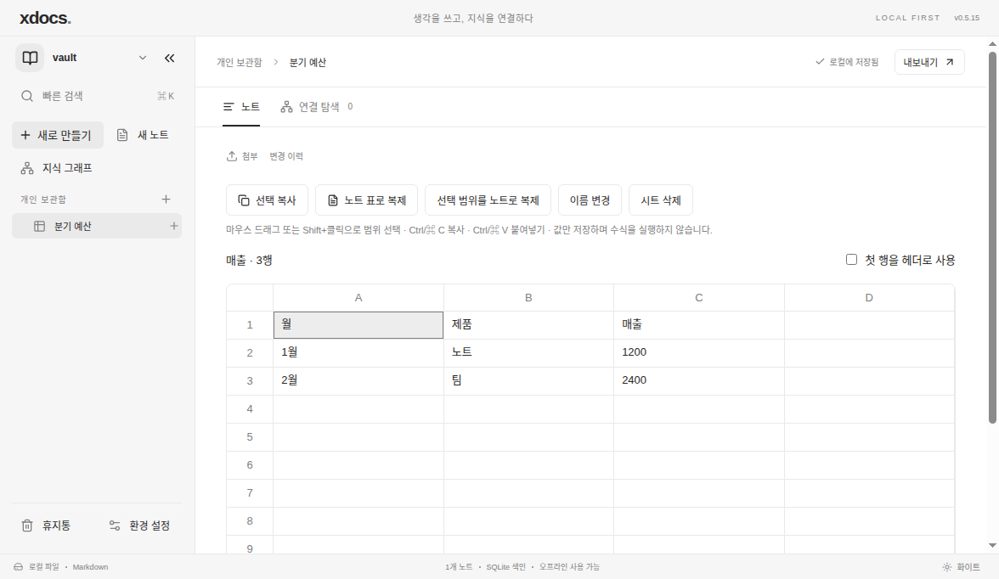

# 시트 탭형 테이블

**새 시트 테이블**에서 독립된 시트 문서를 만들거나 **Excel·CSV 시트 가져오기**로 파일을 선택합니다. 시트 탭, 셀 값 편집, 시트 추가·이름 변경·삭제, 행·열 추가를 지원합니다. 계산 엔진은 포함하지 않으며 `=SUM(...)`처럼 입력한 값도 텍스트입니다. Google Sheets와 같은 탭 구조를 제공하지만 Google 계정 연결이나 실시간 Sheets API 동기화는 하지 않습니다.

셀에서 마우스를 누른 채 마지막 셀까지 끌면 직사각형 범위가 선택됩니다. **선택 복사** 또는 Ctrl/⌘+C로 탭 구분 텍스트를 복사할 수 있습니다. 가져온 시트의 첫 행은 기본적으로 데이터입니다. **첫 행을 헤더로 사용**을 켜면 해당 행이 열 제목으로 고정됩니다. 이 설정은 시트별로 저장되며 언제든 해제할 수 있습니다.

## 파일 가져오기

| 입력                                   | 동작                                                                                                |
| -------------------------------------- | --------------------------------------------------------------------------------------------------- |
| `.xlsx`, `.xlsm`                       | 표시된 워크시트마다 탭을 만들고 저장된 셀 값을 읽습니다. 매크로·외부 링크·수식을 실행하지 않습니다. |
| UTF-8 `.csv`                           | 쉼표 구분 표를 하나의 시트로 읽습니다.                                                              |
| UTF-8 `.tsv`, `.txt`                   | 탭 구분 표를 읽습니다. 여러 파일을 한 번에 선택하면 각각 시트가 됩니다.                             |
| `.xls`, `.xlsb`, 암호화·읽기 실패 파일 | 로컬 앱 열기, 원본 첨부, Windows Excel 읽기 전용 가져오기 중 선택합니다.                            |

직접 읽기는 숨김 시트를 제외하며, 빈 셀과 여러 줄 셀을 보존합니다. 병합 셀은 첫 셀의 값만 가져옵니다. 수식은 저장된 결과를 사용하며 결과가 없으면 빈 셀과 안내를 표시합니다. 날짜는 ISO 형식이며 Excel 표시 서식과 다를 수 있습니다. 차트·이미지·서식·매크로를 표에 재현하지는 않습니다. 원본 파일은 수정하지 않습니다.

[참고한 xl2txt](https://github.com/uknowpro/xl2txt)의 결과를 가져오려면 구분자를 **탭**으로 선택하고, 생성된 TXT 파일들을 함께 선택하세요. UTF-8 BOM, CRLF, 따옴표 안의 탭·줄바꿈·큰따옴표를 처리합니다.

## 읽을 수 없는 파일과 권한

DRM, 암호, 보호된 보기, 조직 정책을 해제하거나 완화하지 않습니다. 파일을 직접 읽지 못하면 사용자에게 선택을 받습니다.

- **로컬 Excel / 기본 앱으로 열기**: 선택한 원본을 운영체제의 연결된 앱으로 엽니다. 인증 후 허용되는 CSV/탭 구분 UTF-8 TXT로 내보내고 다시 가져옵니다. Ubuntu에서는 설치된 기본 스프레드시트 앱을 사용합니다.
- **원본만 노트에 첨부**: 파일을 보관함에 복사하며 표로 변환하지 않습니다. 이후 노트에서 원본을 열 수 있습니다.
- **Excel에서 읽기 전용으로 가져오기**: Windows에서 설치된 Excel의 별도 인스턴스를 사용합니다. 매크로와 이벤트를 비활성화하고 외부 링크를 갱신하지 않습니다. 인증·암호 창은 Excel에서 직접 처리하며, 문서 권한 제한이 감지되거나 Excel이 읽기를 거부하면 중단합니다. PowerShell 실행 정책도 우회하지 않습니다. Windows + Excel 실기기 검증은 아직 필요합니다.

## 복사와 노트 변환

셀 클릭 → Shift+다른 셀 클릭으로 사각 범위를 선택합니다. **선택 복사** 또는 Ctrl/⌘ C는 열 사이에 탭, 행 사이에 CRLF를 사용합니다. 탭·줄바꿈·따옴표가 있는 셀은 큰따옴표로 감싸서 빈 셀과 여러 줄 셀을 유지합니다. Ctrl/⌘ V로 Excel·Sheets의 탭 구분 텍스트를 붙여넣을 수 있습니다. 표 안에서는 Tab/Shift+Tab과 위·아래 화살표로 이동하며, Alt+화살표는 셀 안의 텍스트 이동에 사용할 수 있습니다.

**노트 표로 복제**는 현재 시트를 Markdown 표가 있는 새 노트로 만듭니다. 첫 행이 표의 제목 행이 됩니다. 일반 Markdown 표에도 **표 복사 (탭 구분)** 버튼과 선택 영역 복사가 있습니다.

## 저장과 한계

시트 문서는 보관함의 `.md` 파일 안에 `xdocs-sheets` 코드 블록으로 저장합니다. 기존 자동 저장·변경 이력·조직 동기화가 적용됩니다. HTML/PDF 내보내기는 시트별 표로 변환하고 Markdown 내보내기는 재편집 가능한 원본 표현을 보존합니다. 시트 파일의 원본 첨부는 별도 기능입니다.

- 입력 파일 25 MB, 압축 해제 합계 64 MB, 시트 50개, 시트당 10,000행·256열, 전체 100,000셀·4 MB 텍스트 제한.
- 읽기는 별도 작업 스레드에서 수행하며 30초 제한과 메모리 제한이 있습니다.
- 화면은 100행씩 표시합니다. 서버 첨부파일은 파일당 4 MB, 로컬 첨부는 25 MB입니다.
- 시트 테이블은 문서 버전 기반으로 동기화합니다. 같은 시트의 셀을 여러 기기에서 동시에 수정하면 기존 문서 충돌 처리로 사본을 보존하세요. 셀 단위 CRDT 공동 편집은 지원하지 않습니다.
