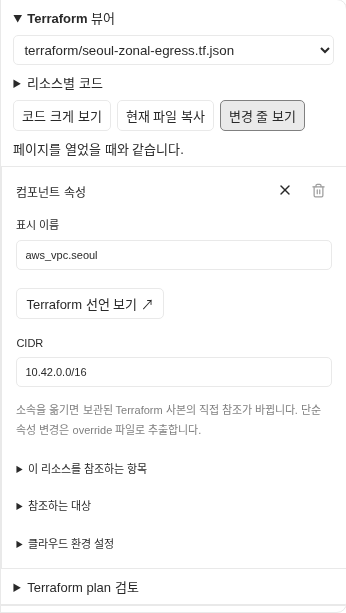

# 데스크톱 UI 점검

## 가장 먼저 수정한 화면

서울 이중 AZ 템플릿에서 VPC를 선택하고 **변경 줄 보기**를 누르면 한 줄짜리 결과에도 Terraform 뷰어가 오른쪽 영역의 52%를 선점했다. 그 아래 속성과 검토 목록은 각각 작은 스크롤 영역이 됐다. 뷰어, 속성, 검토 항목을 한 열에 내용 높이로 배치하고 패널이 세로 스크롤을 담당하도록 수정했다. 긴 코드만 내부에서 스크롤한다. **코드 크게 보기**에서는 코드 자체의 높이 제한도 해제한다.

1536×864 CSS 픽셀에서 오른쪽 패널 높이는 556px, 변경 내용이 한 줄일 때 뷰어 높이는 166px였다. 상태 문구 끝과 뷰어 하단 사이에는 9px가 남았다. 표시 이름과 CIDR 입력칸이 모두 첫 화면에 들어왔다.

## xinfra와 Analyzer의 변경 사항

| 작업 | 확인할 위치와 동작 |
|---|---|
| 1. 배율 | 설계 도구의 배율 목록에서 전체 맞춤·100%·선택 항목 맞춤을 바꾼다. 실제 크기로 본 상태에서 패널 폭이 변하면 도면 중심을 보정한다. |
| 2. 검색 | 리소스 이름·주소·상위 네트워크 이름으로 검색한다. Enter로 선택하면 접힌 상위 경계를 열며, 사례 삽화에 생략된 리소스는 경계 도면으로 이동한다. |
| 3. 연결선 | 사례 도면에서 NAT를 선택하면 직접 연결된 경로가 강조된다. 라벨은 리소스와 앞서 배치한 라벨을 피해 빈 위치를 찾는다. |
| 4. 코드 탐색 | 리소스를 클릭해 대응 파일과 강조된 선언 행을 찾는다. 코드의 선언 행을 누르면 같은 도면에서 해당 리소스가 선택된다. |
| 5. 크기 회귀 검사 | AWS·Azure·GCP의 각 대표 사례에서 짧은 변경 비교와 속성을 함께 열어 125%·150%에 해당하는 화면 조건을 검사한다. |
| 6. 경계 재배치 | 경계 도면에서 호환되는 경계로 드래그한다. 놓기 전에 대상과 바뀔 참조 필드를 확인하고, 놓은 뒤 변경 영향에서 코드 차이를 읽는다. 가져온 표현식은 직접 참조를 검증할 수 있을 때만 이동한다. |
| 7. 접힌 경계 | 경계를 선택해 접으면 숨긴 리소스 수와 경계를 드나드는 선택 범위의 참조를 볼 수 있다. |
| 8. 왕복 차이 | 코드 추출의 IaC 변경 비교에서 파일별 diff와 원문 그대로인 파일을 확인한다. 원본과 바이트 내용이 같은 파일만 보존 목록에 들어간다. |
| 9. 템플릿 | 공급자·업무 시나리오로 필터링하고, 각 카드에서 썸네일과 설계 목적을 함께 읽는다. |
| 10. 분석 경로 | Analyzer의 발견 항목에서 일치하는 경로로 이동한다. 화살표를 선택하면 양 끝 리소스의 파일 근거를 먼저 표시하고, 개별 연결로 좁힐 수 없으면 경로 전체의 근거임을 표시한다. |

## v0.5.24 후속 점검 결과

| 화면 | 반영 사항 |
|---|---|
| 시트 | 긴 시트는 탭과 하단 조작 영역까지 고려해 높이를 계산한다. 짧은 가져오기 파일은 실제 행 수만 표시한다. |
| xcode | 창 크기와 상단 패널에 맞춰 대화 높이를 계산하고 전송 버튼을 입력란 옆에 둔다. 설정 JSON 검증 오류는 해당 위치로 이동한다. |
| 템플릿 선택 | 갤러리와 설명을 한 번에 스크롤하고 선택 이름과 생성 버튼은 고정한다. |
| Harness·Office | 4단계 이상 하네스는 단계별로, 8개를 초과하는 양식 필드는 8개씩 묶어 접을 수 있다. |
| xinfra 속성 | 오른쪽 패널을 아래로 스크롤한 뒤 도면에서 다른 리소스를 선택하면 해당 속성 제목이 보인다. |
| Terraform 변경 비교 | 변경된 파일 사이에서 이전·다음으로 이동하고 현재 순서를 확인한다. |
| 페이지 트리 | 잘린 이름은 마우스나 키보드 포커스에서 전체 상위 경로와 함께 표시한다. |
| 지식 그래프 | 제목 옆에 범위를, 검색 입력 옆에 결과 수를 둔다. |
| Analyzer | 근거 파일별로 관련 경로를 열고 재분석 뒤에도 같은 경로를 찾아간다. |
| 인프라·자동화 원문 | 인프라 원문 탭에서 선택한 파일은 메모리에서 읽는다. 관계 도면·파일·자동화 블록 사이에서 편집 위치를 복원한다. |
| 문서 스크롤 | 가로로 이동한 넓은 표와 목차 이동을 390px와 1366px에서 회귀 검사한다. |
| 조직 동기화 | 충돌 원문을 나란히 비교하고 긴 비교에서도 사본 보존과 서버 버전 적용 동작에 접근한다. |

## 참고한 오픈소스

로컬 AppFlowy 소스의 리비전은 `8fcee27d9`다. 사이드바 헤더는 접기 동작을 제목 행에 두고, 크기 조절 경계는 선과 드래그 영역을 분리한다. 즐겨찾기 보조 작업은 툴팁이 있는 아이콘과 팝오버 안에 둔다. xdocs에서는 편집할 값을 먼저 보이고 드물게 쓰는 검토를 접어 두는 기준으로 참고했다. [헤더](https://github.com/AppFlowy-IO/AppFlowy/blob/8fcee27d9/frontend/appflowy_flutter/lib/workspace/presentation/home/menu/sidebar/header/sidebar_top_menu.dart) · [크기 조절](https://github.com/AppFlowy-IO/AppFlowy/blob/8fcee27d9/frontend/appflowy_flutter/lib/workspace/presentation/widgets/sidebar_resizer.dart) · [보조 작업](https://github.com/AppFlowy-IO/AppFlowy/blob/8fcee27d9/frontend/appflowy_flutter/lib/workspace/presentation/home/menu/sidebar/favorites/favorite_more_actions.dart)

## 재현 방법

`npm run test:ui -- --workers=1`로 페이지 이동과 실제 브라우저 레이아웃을 검사한다. 오른쪽 패널 회귀 테스트는 AWS·Azure·GCP 템플릿을 각각 열고, 1920×1080 화면의 125%·150%에 해당하는 CSS 뷰포트와 픽셀 밀도에서 빈 공간·속성 내부 스크롤·가로 넘침을 측정한다. Windows와 macOS 네이티브 글꼴·시스템 배율은 각 OS 설치본에서 별도로 확인할 항목이다.
